# 当日店舗受け取りECアプリ 基本設計書

版：1.2／作成日：2026年9月13日／更新日：2026年11月1日／状態：確定版
正式なアプリ名：未定（本書の画面例では仮称「Pickup App」を使用）
関連文書：[要求定義書](./01_要求定義書.md)、[要件定義書（v0.4）](./02_要件定義書.md)、[詳細設計書](./04_詳細設計/00_実装ガイド.md)、[テスト仕様書](./05_テスト仕様書.md)

## 1. はじめに

> **実装時の注意（v1.1）**：実装に必要な詳細（テーブルの全列、APIの入出力、計算式、画面の文言、環境設定）は [詳細設計書](./04_詳細設計/00_実装ガイド.md) に定めた。テストケースは独立した[テスト仕様書](./05_テスト仕様書.md)に定める。本書と詳細設計書が食い違う場合は詳細設計書を優先する。v1.1で変わった主な点は1.5節にまとめた。

### 1.1 目的

本書は、要求定義書および要件定義書で定めた振る舞いを、画面、業務フロー、システム構成、データ、API、セキュリティの観点から実現可能な形に具体化する。

実装クラス、関数、物理テーブルの詳細、フレームワーク固有のコード構成は詳細設計書で扱う。本書では、利用者から見える振る舞いとシステム間の責任分担を確定対象とする。

### 1.2 記載内容の状態

| 表記 | 意味 |
|---|---|
| 合意済み | 要求定義書または要件定義書でプロジェクトオーナーが選択済みの内容 |
| 設計条件 | システム構成・セキュリティ・成果物に関する必須条件 |
| 提案 | AIが基本設計の初稿として補った内容。レビュー後に確定する |
| 未決定 | 実装前にプロジェクト関係者との確認が必要な内容 |

### 1.3 対象範囲

対象は、選択店舗の商品を注文し、当日以降に店舗で受け取るEC機能と、それを処理する店員機能である。

- 購入者：店舗選択、商品検索、注文、状況確認、QR表示、条件を満たす注文の取消
- 代理受取人：購入者から受け取ったQRによる商品受け取り
- 店員：注文準備、欠品・遅延登録、QR照合、引き渡し、受付停止・再開
- 店員（POS・在庫）：簡易POSによる店頭売上の登録・取消、入荷登録、棚卸・破損による在庫調整、在庫履歴の確認
- 外部サービス：Stripe（テストモード）による決済、メール送信
- 追加候補：AIによる商品相談（本書では設計対象外とし、着手時に追記する）

簡易POSと在庫管理は、EC注文と店頭販売が同じ店舗在庫を使うため、必須の機能範囲とする（プロジェクトオーナー判断、2026年10月31日）。

本アプリは本番稼働させない。Azure上のテスト環境に構築し、Stripeのテスト環境（テストモード）を使って試験するまでを範囲とする（プロジェクトオーナー判断、2026年10月31日）。実際の決済・実在する顧客の個人情報は扱わない。

自宅配送、他店舗・倉庫からの取り寄せ、実在するGUのPOSとの連携、実際の金銭を扱う本番決済は対象外とする。

### 1.4 追加された設計条件

`SC` は System Constraint（システム制約・設計条件）を表す。要求定義書・要件定義書の確定後に追加された条件である。

出典：受講している講座の課題として示された条件。課題であることとは別に、プロジェクトオーナーが本プロジェクトで使いたい技術・設計方針として採用を決めている（2026年10月31日確認）。

| ID | 設計条件 | 本書での扱い |
|---|---|---|
| SC-01 | UMLの利用 | ユースケース図、アクティビティ図、シーケンス図、クラス図を記載 |
| SC-02 | ログイン、JWT、認証・認可 | 認証構成、権限表、トークン方針を記載 |
| SC-03 | POSレジ機能 | 本システム内の簡易POSと在庫管理（入荷・調整・履歴）として画面、API、データを設計。必須範囲 |
| SC-04 | BFF、リバースプロキシ、CORS | システム構成と通信制御を記載 |
| SC-05 | Frontend計算値とBackend計算値の照合 | 注文受付シーケンスとエラー処理を記載 |
| SC-06 | Swagger Docs非表示 | 本番環境で無効化する方針を記載 |
| SC-07 | SQLインジェクション対策 | ORM、パラメータ化、入力検証を記載 |
| SC-08 | Frontend TypeScript | 型定義方針とAPI DTOを記載 |
| SC-09 | ORM | データアクセス方針を記載 |
| SC-10 | OSS脆弱性・バージョン調査 | 選定基準、記録方法、検査方法を記載 |
| SC-11 | 入力値・商品数・エラー処理 | 入力制約表、共通エラー形式を記載 |
| SC-12 | API一覧、入出力、型 | API一覧と主要DTOを記載 |
| SC-13 | ER図 | 論理ER図を記載 |

SC-01〜13は要件定義書v0.3の2.4節と、関連する機能要件・非機能要件（F-19〜F-22、N-06・N-07、S-07〜S-09）に反映済みである。特にSC-03は、要件定義書T-02「在庫登録と通常販売の更新方法」と要求定義書5.4「店舗側の在庫更新方法は別途決める」に対する解決案を兼ねる。開発計画は別途作成せず、本書をもとに実装へ進む（20.2 BD-T09）。

### 1.5 v1.1での主な変更（詳細設計に合わせた変更）

| 項目 | v1.0まで | v1.1 |
|---|---|---|
| Azureの料金プラン | Basic以上を想定 | App Service Free（F1）。MySQLは課題で提供された共有サーバー |
| 定期処理 | Backend内に常駐するスケジューラー（Always On必須） | 常駐させない。時間で変わる状態は読むときに確定させ、取りこぼしはGitHub Actionsから10分ごとにジョブ実行API（API-38）を呼んで回収する（7.6） |
| 秘密情報・監視 | Key Vault、Application Insights | 使わない。App Serviceのアプリ設定と標準ログ |
| Backendの公開 | 未決定（BD-T04） | BFFとの共有秘密ヘッダーがある要求だけ受け付ける。CORSは許可しない |
| 運営担当 | 画面・APIの要否は未決定（BD-T06） | 画面・ロール・API-33・34は作らない。障害対応は管理コマンド |
| メール | サービス未決定（T-07） | 既定は送信せずDBに保存し、開発用画面（DEV-01）で確認。SMTPへ切替可 |
| QR | 表示開始・再発行は未決定（T-06） | READYから表示、購入者が再発行可、手入力コード6桁（BD-T05） |
| API | API-01〜35 | API-36（支払結果の確認）、API-37（QR再発行）、API-38（ジョブ実行）、API-39（送信メール一覧）、API-40（ログイン中の利用者）、API-41（店員の注文詳細）を追加。POSの見積もり（API-25）は保存せず、estimateIdを使わない |
| 画面 | ― | DEV-01（送信メール一覧、開発用）を追加 |

## 2. 設計方針

### 2.1 基本方針

1. 注文前に、具体的な準備完了予定日時を目立つ位置に表示する。
2. 画面に表示した価格、数量、予定日時をBackendで再計算し、Frontendの値を信用しない。
3. 注文、決済、在庫確保、準備、遅延、受け取りを別々の状態として管理する。
4. 購入者、店員、代理受取人の権限を分ける。
5. 外部サービスの失敗や結果不明を記録し、安全に再確認・再処理できるようにする。
6. 同じ操作が再送されても二重注文、二重決済、二重返金、二重受取を発生させない。
7. 画面とAPIはスマートフォンでの購入操作を優先し、店員画面は店舗端末でも操作できる構成とする。
8. 在庫の増減は、EC注文・POS販売・入荷・棚卸・破損のどれであっても在庫履歴へ記録し、現在庫と履歴を同じトランザクションで更新する。
9. 外部サービスを呼ぶ処理は「呼び出し前に処理中を記録 → 呼び出し → 結果を記録」の順とし、DB更新と外部呼び出しの片方だけが成功した状態を照合で解消できるようにする。

### 2.2 技術構成の前提

| 項目 | 状態 | 方針 |
|---|---|---|
| アプリ形式 | 合意済み | Webアプリケーション（要件定義書2.1）。購入者・店員がブラウザから利用するレスポンシブ構成は提案 |
| Frontend | 合意済み／提案 | Next.jsの採用は合意済み。16.x、App Router、TypeScriptの使用は提案（TypeScriptはSC-08） |
| BFF | 設計条件／提案 | BFFの設置はSC-04。Next.js Route Handlersで実装し、ブラウザ向けAPI、JWTの安全な受け渡し、FastAPIへのリバースプロキシを担当する案 |
| Backend | 合意済み／提案 | FastAPIの採用は合意済み。0.141.x系列は提案。価格、数量、権限、在庫、予定時刻を必ず再検証 |
| Database | 合意済み／提案 | Azure Database for MySQLは合意済み。提供されたFlexible Server、MySQL 8.4を利用する |
| ORM | 設計条件／提案 | ORMの使用はSC-09。SQLAlchemy 2.0.xとAlembicによるスキーマ管理は提案 |
| 認証 | 設計条件 | JWTを用い、購入者・店員のロールを区別（SC-02） |
| 決済 | 合意済み | Stripeのテスト環境（テストモード）。PaymentIntentを `capture_method=manual` で作成して利用枠を確保し、準備完了時に用意できた金額だけ確定する（一部確定時、残額は自動で解放）。3DセキュアとWebhookを使う。決済処理は差し替え可能な部品に分ける |
| 通知 | 合意済み | 既定は送信せずDBに保存し、開発用画面で確認する。SMTPの設定時だけ実送信する（T-07） |
| 定期処理 | 合意済み | 常駐させない。時間で変わる状態は読むときに確定させ、取りこぼしはGitHub Actionsの定期実行（10分ごと）からBackendのジョブ実行API（API-38）を呼んで回収する。MySQLの名前付きロック（GET_LOCK／RELEASE_LOCK、DB名で名前空間を分離）で多重実行を防ぐ（7.6） |
| 配置先 | 合意済み | Frontend（Next.js＋BFF）とBackend（FastAPI）のソースコードを分け、それぞれ別のAzure App Serviceへデプロイする（3.4） |
| 秘密情報 | 合意済み | App Serviceのアプリ設定（環境変数）に置く。Key Vaultは使わない |
| 監視 | 合意済み | App Serviceの標準ログ（ログストリーム）。Application Insightsは使わない |

採用する版は詳細設計書 00_実装ガイド 2章で固定する。パッチ版は実装開始日に脆弱性と互換性を再確認し、ロックファイルへ記録する（16.9）。Azureの料金プランはFree（F1）とする（BD-T01）。

### 2.3 ORMの位置づけ

ORM（Object-Relational Mapper）は、データベースのテーブルとPythonのクラスを対応付け、SQLを直接組み立てずにデータを読み書きする仕組みである。本システムでは、FastAPIからMySQLを操作するためにSQLAlchemyを使用する案とする。

ORMはテーブル間の関連、入力値のバインド、トランザクション管理を扱いやすくする。ただし、ORMを採用するだけで在庫競合やSQLインジェクションがすべて自動解決されるわけではない。Raw SQLの文字列連結を禁止し、入力検証、DB制約、トランザクション、ロックを組み合わせる。

## 3. システム構成

### 3.1 全体構成図

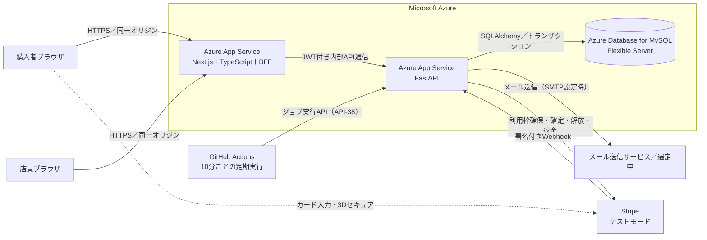

カード情報は決済サービスが提供する入力部品へ購入者のブラウザから直接送り、アプリのサーバーを経由させない（S-03）。メールはAPIから直接送らず、送信待ちとしてDBへ登録し、定期処理が送信する（7.6）。

### 3.2 各要素の責任

| 要素 | 主な責任 |
|---|---|
| Next.js Frontend | 入力、入力補助、画面遷移、暫定金額・数量の表示、利用者向けエラー表示 |
| Next.js BFF | ブラウザ向けAPI、JWTの受け渡し、CSRF対策、FastAPIへのリバースプロキシ、CORS境界の単純化 |
| FastAPI Backend | 認可、業務ルール、価格・数量・予定時刻の再計算、状態遷移、排他制御、在庫履歴の記録、外部サービス連携、決済Webhookの署名検証 |
| ジョブ（Backend内の関数） | 予定超過の遅延表示、仮確保の期限切れ解放、決済結果の照合、受取期限超過、メール送信・再送、在庫の整合確認（7.6）。API-38・管理コマンド・各APIの処理の中から呼ぶ |
| GitHub Actions | 10分ごとと毎日3:00にAPI-38を呼ぶ |
| MySQL | 会員、商品、在庫・在庫履歴、注文、決済、受け取り、POS売上、通知、監査履歴の永続化 |
| SQLAlchemy | Pythonクラスとテーブルの対応、クエリ、トランザクションの制御 |
| Alembic | DBスキーマ変更履歴の作成・適用 |
| Stripe（テストモード） | カード情報の受け取り（Stripeの入力部品）、3Dセキュア、利用枠確保、決済確定、利用枠解放、返金、結果のWebhook通知。試験はStripeのテスト用カード番号で行う |
| メールサービス | 準備完了、遅延、欠品変更、取消の通知 |

### 3.3 ネットワーク境界

- ブラウザは原則としてBFFだけを呼び出し、Backendを直接公開しない。
- BFFからBackendへの転送先は固定し、利用者入力を転送先URLとして使用しない。
- Backendを別オリジンで公開する必要がある場合、CORSはBFFの許可済みオリジンだけを列挙する。
- 認証情報を伴う通信で `Access-Control-Allow-Origin: *` を使用しない。
- 開発、テスト、本番の許可オリジンを環境変数で分離する。
- BackendはBFFとの共有秘密ヘッダー（`X-BFF-Secret`）がある要求だけを受け付け、CORSは許可しない。例外は、Stripeから直接届く決済Webhook（署名で検証）と、GitHub Actionsから呼ぶジョブ実行API（別の秘密ヘッダーで検証）、ヘルスチェックだけとする。

### 3.4 配置とソースコード構成

ソースコードはFrontendとBackendで分け、それぞれ別のAzure App Serviceへデプロイする。設計書と同じ親フォルダに並べる。

```text
GUアプリ/
├── gu-docs/    01_要求定義書.md・02_要件定義書.md・03_基本設計書.md・04_詳細設計/・05_テスト仕様書.md
├── frontend/   Next.js（画面＋BFF）。Frontend用App Serviceへデプロイ
└── backend/    FastAPI（API＋定期処理）。Backend用App Serviceへデプロイ
```

| 項目 | Frontend | Backend |
|---|---|---|
| 内容 | Next.js（App Router、TypeScript）、BFF（Route Handlers） | FastAPI、SQLAlchemy、Alembic、ジョブ（API-38から実行）、管理コマンド |
| デプロイ先 | Azure App Service（Node 24 LTS、Free F1） | Azure App Service（Python 3.12、Free F1） |
| デプロイ | フォルダごとに独立したデプロイ手順（例：GitHub Actionsのワークフローを別々に用意） | 同左 |
| 主な設定値 | BackendのURL、Cookie・CSRF設定、Stripe公開キー | DB接続情報、JWT署名鍵、Stripe秘密キー・Webhook署名シークレット、メール送信設定 |
| 秘密情報 | App Serviceのアプリ設定 | 同左 |

- App ServiceはFree（F1）プランを使う。Freeプランでは Always On が使えず、CPU時間は1日60分、メモリは1GB、インスタンスは1つである。通信がしばらくないとアプリは停止し、次のアクセスで起動する。このため定期処理をアプリ内に常駐させず、GitHub Actionsから定期的にジョブ実行APIを呼ぶ（7.6）。この呼び出しが停止中のアプリを起こす役割も兼ねる。
- 試験中にCPU時間の上限でアプリが止まる場合は、Basic（B1）に変更する。アプリの変更は不要。
- `GUアプリ` フォルダ全体を1つのGitリポジトリにし、GitHub Actionsで `frontend/` と `backend/` を別々にデプロイする。手順は詳細設計書 05_インフラ・設定 3章。

参考：[Microsoft Learn：Azure App Serviceの制限（Free：Always On非対応、CPU 60分/日など）](https://learn.microsoft.com/en-us/azure/azure-resource-manager/management/azure-subscription-service-limits#azure-app-service-limits)

## 4. 利用者と権限

### 4.1 アクター

| アクター | 説明 |
|---|---|
| 未ログイン利用者 | 店舗・商品を閲覧できる。注文や注文詳細の閲覧はできない |
| 購入者 | 自分の注文、取消、QRを操作できる |
| 代理受取人 | QRを提示して受け取れるが、購入者の注文履歴や取消権限は持たない |
| 店員 | 自店舗の注文準備、欠品・遅延、QR照合、引き渡し、受付停止・再開、簡易POS、在庫の入荷・調整を操作できる |
| 運営担当 | アプリの利用者としては作らない（ロール・画面なし）。障害対応はBackendの管理コマンドで行う（詳細設計書 03_業務ロジック 12.3） |

### 4.2 権限表

○：可、×：不可、―：該当しない

| 操作 | 未ログイン | 購入者 | QR所持者 | 店員（自店舗） |
|---|:---:|:---:|:---:|:---:|
| 店舗・商品閲覧 | ○ | ○ | ○ | ○ |
| 会員登録 | ○ | ― | ― | ― |
| 注文 | × | ○ | × | × |
| 自分の注文一覧・詳細、QRの表示・再発行 | × | ○ | × | ― |
| 遅延が発生した注文の取消 | × | ○ | × | × |
| QR提示 | ― | ○ | ○ | ― |
| 自店舗の注文の照会 | × | × | × | ○ |
| 注文準備・欠品登録・遅延登録 | × | × | × | ○ |
| QR照合・引き渡し確定・期限切れ品の棚戻し | × | × | × | ○ |
| 受付停止・再開、営業時間の登録 | × | × | × | ○ |
| 簡易POS売上登録・取消 | × | × | × | ○ |
| 入荷登録・在庫調整、在庫・在庫履歴の照会 | × | × | × | ○ |
| 他店舗のデータ操作 | × | × | × | × |
| 送信メール一覧（開発用） | × | 自分宛て | × | 自店舗の注文 |

決済・通知の照合や再処理、監査ログの確認は、運営担当の画面ではなくBackendの管理コマンドとDBで行う。在庫調整は店員全員が理由を必須として登録でき、監査履歴に残す（BD-T10、決定）。

## 5. UML：ユースケース図

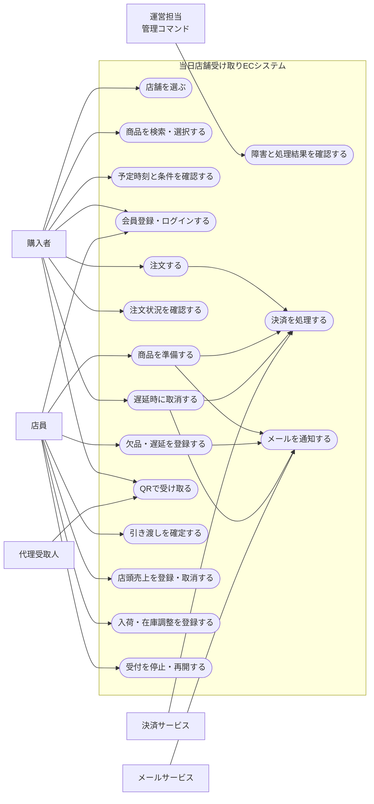

本書のユースケースIDは `BUC-xx`（基本設計ユースケース）とし、要件定義書4章の `UC-01〜UC-05` とは区別する。主な対応：UC-01→BUC01・02、UC-02→BUC03〜05、UC-03→BUC08・09、UC-04→BUC07・09、UC-05→BUC10・11。BUC12・13・17はSC-03・O-01から追加した。

## 6. UML：アクティビティ図

### 6.1 購入者が注文する

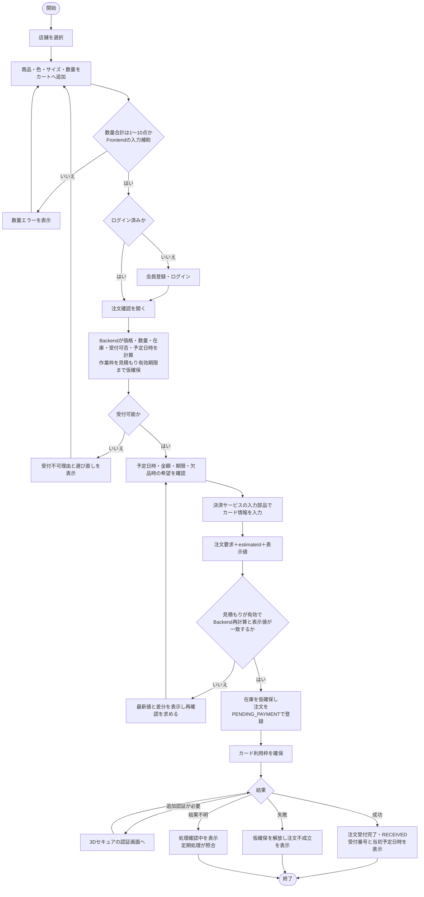

- 予定日時はBackend（見積もりAPI）だけが計算する。Frontendは数量と暫定金額だけを計算する。
- 見積もりは有効期限（10分、BD-T13）の間、作業枠を仮確保する。注文要求時にBackendが予定日時を再計算し、見積もり時の予定より許容幅（5分、BD-T13。T-01の余裕時間の範囲内）を超えて遅くならなければ、画面に表示した見積もり時の予定日時を「注文時の予定（当初予定）」として保存する（F-06、A-03）。許容幅を超える場合や見積もりが期限切れの場合は409で最新値を返す。
- 在庫は注文要求の時点で仮確保（15分、BD-T13。3Dセキュアの時間を含む）し、利用枠確保が成功したら確定、失敗・期限切れなら解放する。
- 受付締切（閉店1時間前）は注文要求の受信時刻で判定する。閉店1時間前ちょうどまで受け付ける（21時閉店なら20:00:00まで可、20:00:01以降は不可）。予定時刻の計算と受付判定は7.7に従う。

### 6.2 店員が商品を準備する

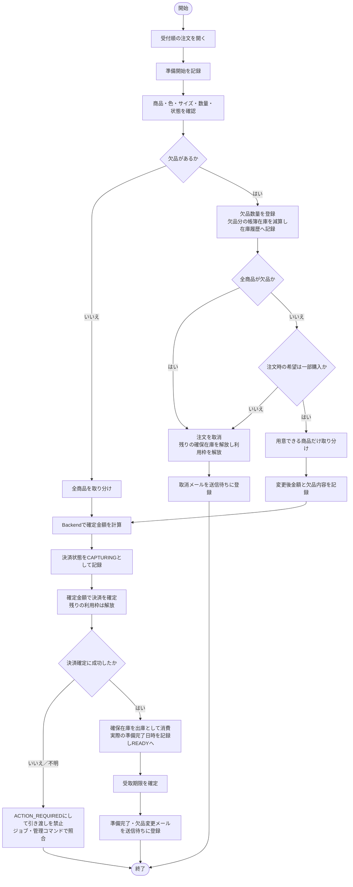

欠品は「帳簿上の在庫より現物が少ない」ことを意味するため、欠品数量の確保は解放して販売可能数へ戻すのではなく、帳簿在庫から減算する（在庫履歴の種別 `EC_SHORTAGE`）。これにより、同じ商品が再び注文されて欠品が繰り返されることを防ぐ（O-02）。

### 6.3 QRで商品を引き渡す

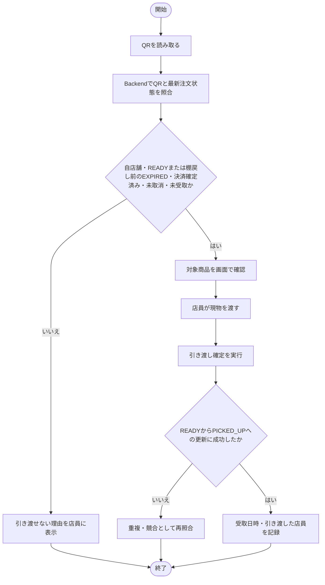

受取期限を過ぎた注文（EXPIRED）も、店員が商品を棚に戻すまでは引き渡せる（T-05）。棚に戻した後のQRは無効とする。

### 6.4 店員が店頭売上を登録する（簡易POS）

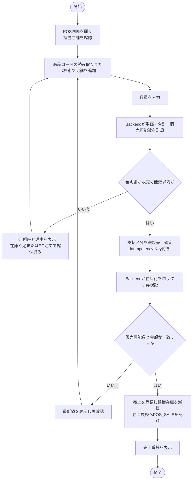

### 6.5 店員が入荷・在庫調整を登録する

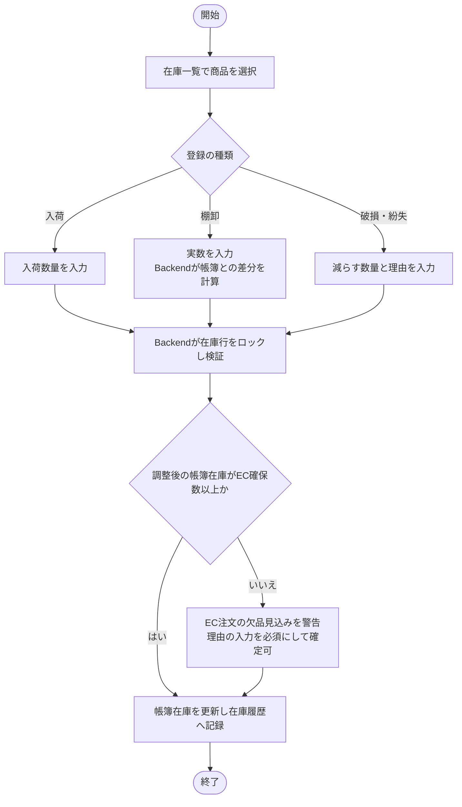

調整後の帳簿在庫がEC注文の確保数を下回る場合は、現物が足りないことが確定しているため、調整自体は記録する。確保数を超えた分の注文は準備時に欠品として扱われる。この場合、`reserved_quantity <= on_hand_quantity` の制約を一時的に満たせなくなるため、扱いは10.5で定める。

## 7. 業務フローと状態設計

### 7.1 全体業務フロー

```text
購入者：店舗選択 → 商品選択 → 予定確認 → 注文 → 状況確認 → QR提示
店員　：注文一覧で受付順に確認 → 準備開始 → 現物確認 → 決済確定 → 準備完了 → 引き渡し
店員（POS・在庫）：入荷登録 → 店頭販売の売上登録 → 棚卸・破損の調整
システム：作業枠・在庫の仮確保 → 状態記録 → 在庫履歴 → 通知 → QR照合 → 二重受取防止
定期処理：予定超過の遅延表示 → 期限切れ解放 → 決済照合 → 期限超過 → 通知送信
```

### 7.2 注文状態

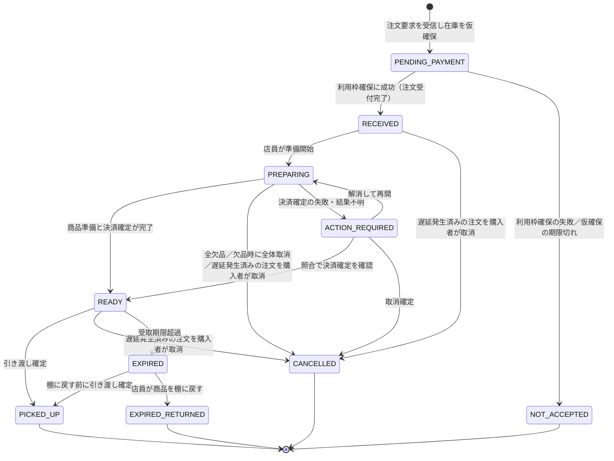

- `PENDING_PAYMENT` は注文受付完了前の状態であり、要件定義書の「注文受付完了」は `RECEIVED` への遷移時点とする（F-06）。この状態の注文は購入者の注文詳細で「支払確認中」と表示し、同じ内容の重複注文を防ぐ。
- 購入者による取消は、店舗都合の遅延が一度でも発生した注文に限る（F-11）。遅延が解消してREADYになった後も、受け取り前なら取消できる。遅延と無関係な取消（利用者都合）は初期実装では設けない（T-03）。
- 取消と引き渡しが同時に操作された場合は、`version` を条件にした更新でどちらか一方だけを成立させる（T-04、A-12）。
- 受取期限は「準備完了日の1週間後の閉店時刻」とする。その日が休業日の場合は、次の営業日の閉店時刻まで延長する（T-05）。
- 期限を過ぎた注文は `EXPIRED` とし、店員の注文一覧の「期限切れ」タブに表示する。店員が商品を棚に戻すまでは、QRで引き渡せる。
- 店員が「棚に戻す」を実行すると `EXPIRED_RETURNED` となり、商品を帳簿在庫へ戻す（`EC_EXPIRED_RETURN`）。決済確定済みの代金は返金しない（事業方針。注文前に告知する）。本アプリは本番稼働しないため、この条項の法的な有効性の確認は行わない。本番運用する場合は事前に確認が必要である。

### 7.3 決済状態

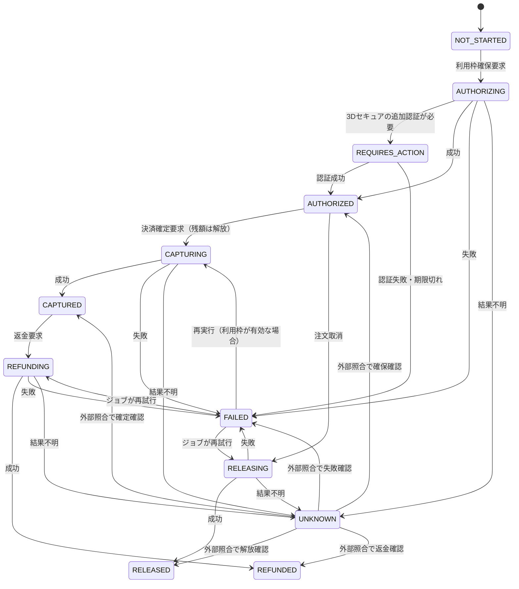

- `FAILED` には失敗した操作（確保・確定・解放・返金）と、外部照合で確認した利用枠の有効性を記録する。確保の失敗は注文不成立、確定・解放・返金の失敗は要対応として運営担当の一覧に表示する。
- 一部購入で確定額が確保額より少ない場合、確定と同時に残りの利用枠を解放し、`captured_amount_yen` と `released_amount_yen` を記録する（F-09）。
- 返金の失敗は処理済みとみなさない（要件定義書UC-04）。
- 決済サービスへの各要求には、操作ごとの冪等キー（例：`{paymentId}:{操作}:{試行番号}`）を渡し、再送で二重に処理されないようにする。

### 7.4 在庫確保の状態

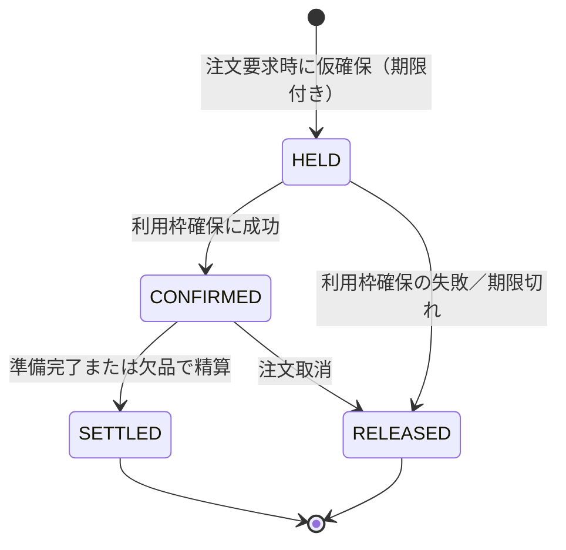

| 状態・操作 | 帳簿在庫 `on_hand` | 確保数 `reserved` | 在庫履歴の種別 |
|---|---|---|---|
| 仮確保（HELD） | 変化なし | ＋数量 | 記録しない（確保の記録はINVENTORY_RESERVATIONS） |
| 取消・期限切れで解放（RELEASED） | 変化なし | −数量 | 記録しない |
| 準備完了で出庫（SETTLEDの消費分） | −用意できた数量 | −用意できた数量 | `EC_PICKUP_OUT` |
| 欠品（SETTLEDの欠品分） | −欠品数量 | −欠品数量 | `EC_SHORTAGE` |
| READY後の取消で棚へ戻す | ＋数量 | 変化なし | `EC_CANCEL_RETURN` |
| 期限切れ品を棚へ戻す | ＋数量 | 変化なし | `EC_EXPIRED_RETURN` |

`SETTLED` では、確保した数量のうち出庫した数量（`consumed_quantity`）と欠品した数量（`shortage_quantity`）を記録する。

### 7.5 状態管理ルール

- 注文状態、決済状態、在庫確保の状態を一つのカラムにまとめない。
- 遅延は注文状態ではなく、遅延の履歴（`ORDER_DELAYS`）と、注文の `isDelayed`（現在遅延中）・`delayOccurred`（一度でも遅延した）で管理する。`delayOccurred` は一度trueになったら戻さない。
- 当初予定（`original_ready_at`）は更新しない。変更後の予定は `updated_ready_at` と遅延履歴で管理する。
- 状態変更時は操作者、日時、変更前、変更後、理由を監査履歴へ記録する。
- 競合が起きる更新ではバージョン番号による楽観ロックまたは行ロックを使用する。
- 引き渡し確定は、READYからPICKED_UPへの変更が1回だけ成功する条件付き更新とする。
- 外部サービスを呼ぶ処理は、呼び出し前に処理中の状態（`AUTHORIZING`、`CAPTURING` 等）をコミットし、呼び出し後に結果を記録する。処理中のまま残った場合は定期処理が外部サービスへ照会して確定させる。
- メール送信は、業務データの更新と同じトランザクションで送信待ち（`NOTIFICATIONS.status = PENDING`）として登録し、コミット直後にBackendのバックグラウンド処理で送信する。取りこぼしはジョブ（J-04）が送る。送信の失敗で業務データの更新を取り消さない。

### 7.6 定期処理

App Service Free（F1）では常駐処理を動かせないため、次の3つを組み合わせる。

1. **読むときに確定させる**：遅延の自動表示（J-01相当）と受取期限超過（J-05相当）は、注文詳細・注文一覧・店員の注文一覧・受け取り照合のAPIが、対象の注文についてその場で判定して更新する。
2. **処理の直後に行う**：メールは登録したトランザクションのコミット直後に送る。決済の結果はStripeのWebhookとAPI-36（支払結果の確認）で反映する。
3. **定期実行で回収する**：GitHub Actionsから10分ごと（毎日3:00は整理・整合確認）にジョブ実行API（API-38）を呼び、取りこぼしを回収する。GitHub Actionsの定期実行は混雑時に遅れることがあるため、1と2で通常の動作が完結するように作る。

| ID | 処理 | 定期実行の間隔 | 内容 | 関連 |
|---|---|---|---|---|
| J-01 | 予定超過の遅延表示 | 10分 | RECEIVED・PREPARING・ACTION_REQUIREDで予定日時を過ぎた注文を遅延中（新予定は確認中）にし、`delayOccurred` をtrueにする。遅延メールを送信待ちに登録 | F-10 |
| J-02 | 見積もり・仮確保の期限切れ | 10分 | 期限切れの見積もりの作業枠を解放する。期限切れのPENDING_PAYMENT注文は、Stripeへ照会して利用枠確保が成功していなければ取消し、NOT_ACCEPTEDにして在庫を解放する | T-02 |
| J-03 | 決済結果の照合 | 10分 | 処理中・結果不明のまま5分以上たった決済をStripeへ照会して状態を確定する。失敗した解放・返金は再試行する | N-04、T-04 |
| J-04 | メール送信・再送 | 10分 | 送信待ちのメールを送り、失敗は間隔を空けて再送する（最大5回） | F-13、T-07 |
| J-05 | 受取期限超過 | 10分 | 受取期限を過ぎたREADYの注文をEXPIREDにする | F-16、T-05 |
| J-06 | 期限切れデータの整理 | 毎日3:00 | 期限切れのIdempotency-Key、リフレッシュトークンを削除する | 16.1 |
| J-07 | 在庫の整合確認 | 毎日3:00 | 帳簿在庫と在庫履歴の合計、EC確保数と有効な確保の合計が一致するかを確認し、差異をログに出す | 10.4、N-03 |

- 各処理は同じ注文に何度実行しても結果が変わらないように作る。
- 同時に実行されないよう、MySQLの名前付きロック（GET_LOCK／RELEASE_LOCK、DB名で名前空間を分離）で処理ごとに1つだけ実行する。
- 詳細は詳細設計書 03_業務ロジック 8・12章。

### 7.7 予定時刻の計算と受付判定（T-01）

要件定義書T-01のAI案を採用する（プロジェクトオーナー判断、2026年10月31日）。準備担当は1人、受付順で作業する前提である。

| 項目 | 計算・判定 |
|---|---|
| 1注文の作業時間 | 2分 × 点数 ＋ 10分（10点で30分） |
| 先行作業 | 同じ店舗で、自分より先に見積もりを作った今日の注文（受付済み・準備中・要対応・支払確認中）と有効な見積もりの作業時間の合計。準備中の注文は完了するまで作業時間全体を数える。自分の前回の見積もりは数えない |
| 予定時刻 | 作業開始時刻（計算時刻。開店前の注文は開店時刻）＋ 先行作業 ＋ この注文の作業時間 ＋ 余裕15分（先行なし・10点なら45分後） |
| 受付可否 | 次をすべて満たす場合に受付可能：①受付状態が受付中、②閉店1時間前ちょうどまで、③予定時刻が作業開始時刻から60分以内（開店前の注文は開店時刻から数える）、④予定時刻が閉店15分前以前、⑤在庫が販売可能数の範囲内 |
| 同時注文 | 店舗行をロックして先行作業を数え、見積もり（作業枠）を保存するまでを1つのトランザクションで行う（9.1） |
| 注文時の予定 | 見積もり時の予定を保存する。注文要求時は見積もりを作った時点を基準に再計算するため、時間の経過や後から来た人の見積もりでは遅くならない。店員が開店時刻を遅らせた場合などで許容幅5分を超えて遅くなる場合は409（6.1、BD-T13） |

例：21時閉店の店舗で、先行作業がない状態で20:00に3点の注文を受け付けた場合、作業時間は16分、予定時刻は20:31となり、受付可能である。20:00に先行作業が30分ある状態で10点の注文を出すと、予定時刻は21:15となり、閉店15分前（20:45）を超えるため受付不可となる。

この式は実測に基づかない初期値であり、当初予定と実際の準備完了日時の記録（要求定義書5.4）をもとに見直す。

## 8. 画面設計

### 8.1 画面一覧

#### 購入者画面

| 画面ID | 画面名 | ログイン | 主な役割 |
|---|---|---|---|
| C-01 | 店舗選択 | 不要 | 店舗、営業時間、受付状態を確認して選択 |
| C-02 | 商品検索・一覧 | 不要 | 選択店舗の在庫商品を検索・絞り込み |
| C-03 | 商品詳細 | 不要 | 商品、色、サイズ、数量を選択 |
| C-04 | カート | 不要 | 数量、暫定金額、10点上限を確認 |
| C-05 | ログイン・会員登録 | 不要 | 購入に必要な会員登録・認証を行う |
| C-06 | 注文・受取条件確認 | 必要 | Backendの見積もりによる予定日時、金額、店舗、期限の数え方、期限超過方針、欠品時希望を確認 |
| C-07 | 支払手続き | 必要 | 決済サービスの入力部品でカード情報を入力し、必要なら3Dセキュアの認証を行う |
| C-08 | 注文受付結果 | 必要 | 受付成否、受付番号、当初予定日時、または「支払確認中」を確認 |
| C-09 | 注文一覧 | 必要 | 自分の注文を一覧表示（注文不成立は直近分のみ） |
| C-10 | 注文詳細・QR | 必要 | 最新状態、当初・更新後の予定、遅延理由、欠品内容、期限、QR、取消可否を表示 |
| C-11 | 取消確認 | 必要 | 取消条件と返金・解放内容を確認して実行 |

カートの扱い（提案）：

- カートは選択中の1店舗の商品だけを入れる。店舗を変更する場合は確認のうえカートを空にする（A-01）。
- カートには商品ID・商品バリエーションIDと数量だけをブラウザに保持し、ログイン後もそのまま使う。価格・在庫は表示のたびにBackendから取得し直す。
- ブラウザのストレージが使えない場合も、画面表示中の状態で注文まで進めるようにする。

#### 店員画面

画面IDは要件定義書のセキュリティ要件ID（S-01〜S-06）と重ならないよう `ST-xx` とする。

| 画面ID | 画面名 | 主な役割 |
|---|---|---|
| ST-01 | 店員ログイン | 店員認証 |
| ST-02 | 注文一覧 | 自店舗の注文を受付順・状態別に表示。遅延・欠品見込み・要対応を強調。受付停止・再開の切替。「期限切れ」タブから商品を棚に戻す |
| ST-03 | 準備詳細 | 明細確認、準備開始、用意できた数量の入力 |
| ST-04 | 欠品登録 | 欠品明細の登録と、欠品時の希望に従った処理結果の確認 |
| ST-05 | 遅延登録 | 理由、新予定または確認中を登録 |
| ST-06 | QR読み取り | カメラまたはコード入力で注文を照合 |
| ST-07 | 引き渡し確認 | 商品と状態を確認し、受取済みを確定 |
| ST-08 | 簡易POS | 商品コードの読み取り・検索で明細を作り、店頭売上を確定して在庫へ反映 |
| ST-09 | POS売上履歴 | 当日の売上一覧・詳細。誤登録の売上取消（在庫を戻す） |
| ST-10 | 在庫一覧 | 商品バリエーション単位の帳簿在庫、EC確保数、販売可能数、欠品見込みを表示・検索 |
| ST-11 | 在庫詳細・履歴 | 1商品バリエーションの在庫と、入荷・販売・EC出庫・欠品・調整の履歴を表示 |
| ST-12 | 入荷・在庫調整 | 入荷、棚卸（実数入力）、破損・紛失を理由付きで登録 |
| ST-13 | 受付・営業時間 | 当日の受付状態、営業時間、休業日の確認と登録 |

運営担当の画面は作らない（BD-T06）。決済・通知の失敗の確認と再処理は管理コマンドで行う。

#### 開発用画面

| 画面ID | 画面名 | 主な役割 |
|---|---|---|
| DEV-01 | 送信メール一覧 | 送信せずDBに保存したメールの内容を確認する。開発用の設定が有効なときだけ表示 |

### 8.2 画面遷移図

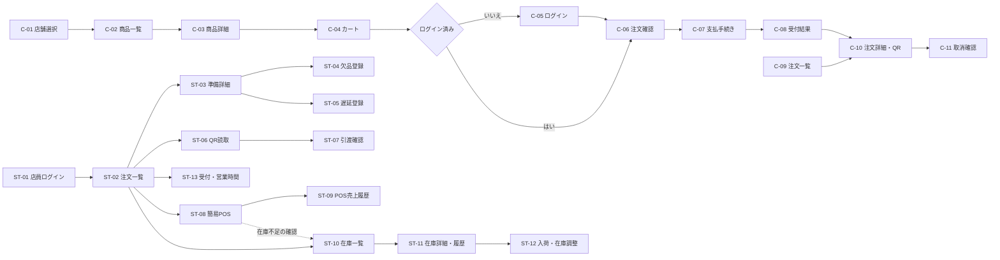

メールのリンクから開いた注文詳細（C-10）は、未ログインならC-05を経由して表示する（A-09）。店員画面は共通メニュー（注文・QR読取・POS・在庫・受付）から各画面へ直接移動できる。

### 8.3 主要画面ワイヤーフレーム

#### C-02 商品検索・一覧

```text
┌──────────────────────────┐
│ Pickup App（仮） 店舗：新宿店 ▾ │
├──────────────────────────┤
│ 🔍 商品名・カテゴリで検索       │
│ [カテゴリ] [色] [サイズ]        │
├──────────────────────────┤
│ 本日の受付：20:00まで           │
│ 最短の準備完了予定：18:40       │
├──────────────────────────┤
│ [画像] 商品名       ¥2,990      │
│        WHITE / S・M 在庫あり    │
│                         [詳細]  │
├──────────────────────────┤
│ ホーム   検索   カート(2) 注文  │
└──────────────────────────┘
```

絞り込み項目はキーワード・カテゴリ・色・サイズ、並び順は新着順・価格の安い順・高い順とする（T-09）。「最短の準備完了予定」は店舗一覧API（API-05）が返す参考値であり、注文時の予定はC-06の見積もりで確定する。店舗名・アプリ名・画像は仮のもので、GUのロゴ・商標・商品画像の利用可否はBD-T07で確認する。

#### C-06 注文・受取条件確認

```text
┌──────────────────────────┐
│ 注文内容の確認                   │
├──────────────────────────┤
│ 受取店舗：新宿店                 │
│ 準備完了予定：本日 18:40         │
│ ※これは現時点の見込みです         │
├──────────────────────────┤
│ 商品A / WHITE / M × 2  ¥5,980  │
│ 商品B / BLACK / S × 1  ¥1,990  │
│ 合計3点                ¥7,970  │
├──────────────────────────┤
│ 欠品時の希望                     │
│ ● 注文全体をキャンセル            │
│ ○ 用意できた商品だけ購入          │
├──────────────────────────┤
│ 受取期限                         │
│ 準備完了日の1週間後の閉店時刻まで │
│ （休業日なら次の営業日の閉店まで） │
│ 期限を過ぎた場合の扱い［全文］     │
│ □ 受取期限と期限超過時の扱いを確認 │
├──────────────────────────┤
│ この内容は 18:30 まで有効です      │
│ [支払手続きへ進む]                │
└──────────────────────────┘
```

予定日時・金額はAPI-08（見積もり）の結果を表示する。見積もりの有効期限を過ぎた場合は再計算して表示し直す。期限超過時の扱い（店舗が商品を棚に戻した後は受け取れず、返金しないこと）の文言は、画面に固定で書き込まず設定値として持つ。

#### C-10 注文詳細・QR

```text
┌──────────────────────────┐
│ 注文 #A12345                    │
├──────────────────────────┤
│ 状態：受け取り可能               │
│ 当初予定：本日 18:40             │
│ 準備完了：本日 18:32             │
│ 受取期限：9/20 21:00             │
│ （遅延時は理由・新予定を表示）     │
├──────────────────────────┤
│          [ QR CODE ]            │
│ 店員にこの画面を提示してください   │
│ QRを渡した代理人も受取可能です     │
├──────────────────────────┤
│ 店舗／商品／確定金額              │
└──────────────────────────┘
```

#### ST-02 店員用注文一覧

```text
┌────────────────────────────────┐
│ 新宿店 注文管理      受付状態：受付中 [停止] │
│ [受付中] [遅延] [要対応] [受取待ち] [期限切れ] │
├────────────────────────────────┤
│ #A123 受付17:30 予定18:15  3点 [準備開始] │
│ #A124 受付17:35 予定18:25 10点 [準備開始] │
│       ⚠ 欠品見込み：商品B/BLACK/S        │
│ #A120 遅延・新予定確認中         [詳細]    │
├────────────────────────────────┤
│ [注文] [QR読取] [POS] [在庫] [受付]        │
└────────────────────────────────┘
```

予定時刻を過ぎた注文は表示時の判定（7.6）で自動的に「遅延」タブへ移り、新予定の登録を促す。「欠品見込み」は、在庫調整で帳簿在庫がEC確保数を下回った商品を含む注文に表示する（10.5）。

#### ST-08 簡易POS

```text
┌────────────────────────────────┐
│ 新宿店 簡易POS              店員：山田    │
├────────────────────────────────┤
│ 商品コード [______________] [読取] [検索] │
├────────────────────────────────┤
│ 商品A / WHITE / M   ¥2,990 × 1  [−][＋] │
│ 商品C / NAVY / L    ¥1,990 × 2  [−][＋] │
│   ⚠ 販売可能 1点（EC注文で1点確保中）     │
├────────────────────────────────┤
│ 合計 3点                       ¥6,970  │
│ 支払区分 ● 現金 ○ カード ○ その他       │
│ [売上確定]                   [クリア]   │
├────────────────────────────────┤
│ [注文] [QR読取] [POS] [在庫] [受付]        │
└────────────────────────────────┘
```

#### ST-12 入荷・在庫調整

```text
┌────────────────────────────────┐
│ 在庫調整：商品C / NAVY / L               │
│ 帳簿在庫 5  EC確保 2  販売可能 3         │
├────────────────────────────────┤
│ 種類  ● 入荷  ○ 棚卸（実数）  ○ 破損・紛失 │
│ 数量  [  3 ]                             │
│ 理由  [______________________]           │
├────────────────────────────────┤
│ 調整後：帳簿在庫 8  販売可能 6            │
│ [登録]                                   │
└────────────────────────────────┘
```

### 8.4 共通表示状態

各一覧・詳細画面は、通常表示だけでなく次の状態を設計する。

- 読み込み中
- データなし
- 通信失敗・再試行可能
- 権限なし
- ログイン期限切れ
- 入力エラー
- 在庫または価格が確認中に変わった
- 見積もりの有効期限切れ
- 3Dセキュアの追加認証中・決済結果確認中
- 受付停止
- 欠品見込みあり（店員画面）
- POSでの販売可能数不足（店員画面）
- 注文の競合更新

## 9. UML：シーケンス図

### 9.1 注文受付

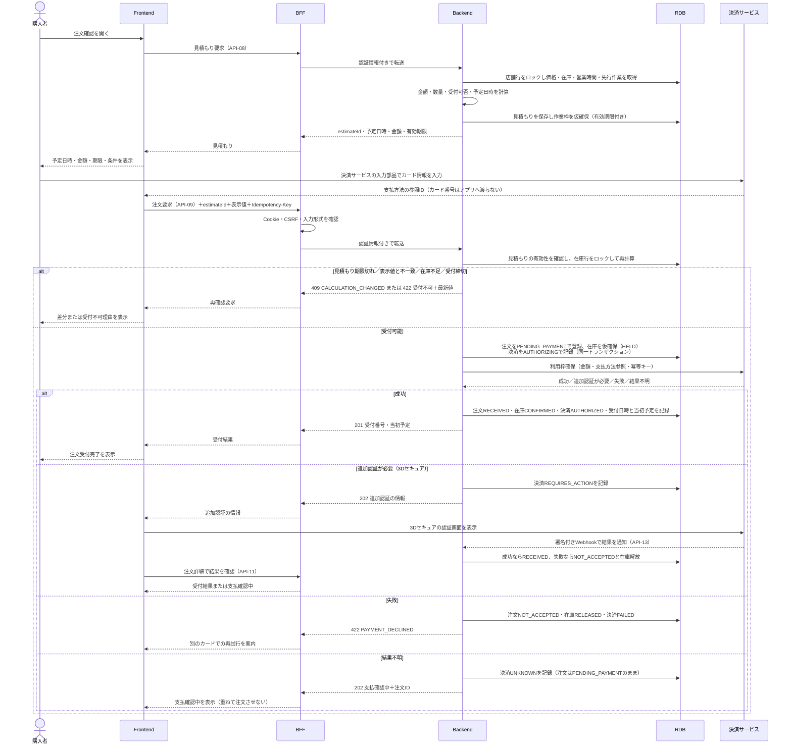

結果不明や追加認証のまま確定しない場合は、定期処理（J-02、J-03）が決済サービスへ照会して確定させる。

### 9.2 準備完了と決済確定

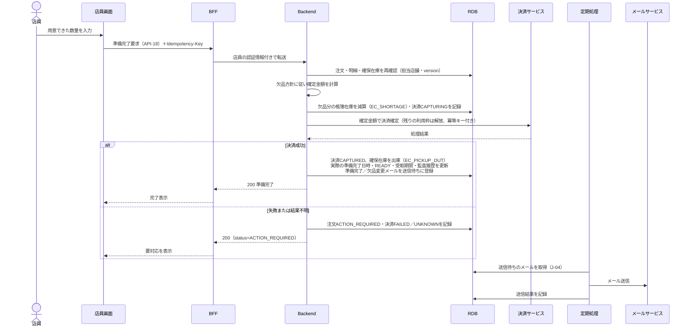

全部欠品、または欠品時の希望が全体キャンセルの場合は、API-16（欠品登録）の時点で注文を取消し、残りの確保在庫と利用枠を解放して取消メールを送信待ちに登録する。

### 9.3 QR照合と引き渡し

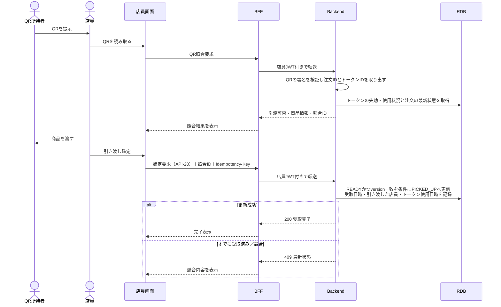

### 9.4 POS売上の登録

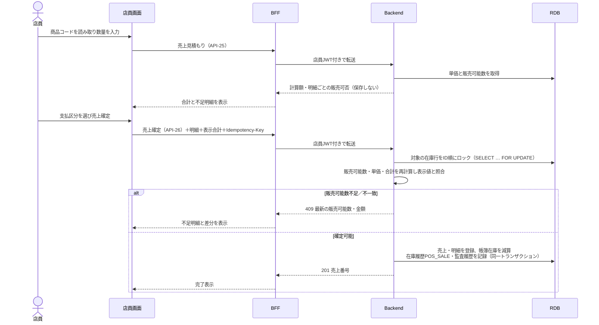

## 10. 簡易POS・在庫管理設計

### 10.1 位置づけ

POSレジ機能は、実在するGUのPOSとの接続ではなく、本システム内の店員向け簡易POSとして実装する。目的は、店頭販売・入荷・棚卸・破損による在庫の増減を記録し、EC注文が使う販売可能数へ即時に反映することである。EC注文とPOSは同じ店舗在庫（`INVENTORIES`）を使い、すべての増減を在庫履歴（`INVENTORY_TRANSACTIONS`）に残す。必須の機能範囲とする（1.3）。

### 10.2 機能範囲

| 区分 | 機能 | 範囲 |
|---|---|---|
| POS | 店員ログインと担当店舗の確認 | 対象 |
| POS | 商品コード（SKU）の読み取り・手入力・商品検索による明細追加、数量入力 | 対象 |
| POS | Backendでの単価・合計の再計算、販売可能数の確認 | 対象 |
| POS | 売上確定、帳簿在庫の減算、在庫不足時の売上拒否 | 対象 |
| POS | 売上番号、店員、日時、明細、支払区分の記録 | 対象 |
| POS | 同一要求の再送による二重売上の防止 | 対象 |
| POS | 当日の売上一覧・詳細、誤登録の売上取消（在庫を戻す） | 対象 |
| 在庫 | 在庫一覧・検索（帳簿在庫、EC確保数、販売可能数、欠品見込み） | 対象 |
| 在庫 | 入荷登録、棚卸（実数入力による差分調整）、破損・紛失の登録 | 対象 |
| 在庫 | 在庫履歴の照会 | 対象 |
| 在庫 | 初期在庫の登録・デモ用の初期化 | 対象（シードデータ・手順で実施） |
| 対象外（決定） | 現金管理、釣銭、カード決済端末との連携、レシート印刷、税務帳票、値引き、返品・交換、店舗間移動、発注 | BD-T02 |
| 対象外（決定） | 商品・価格マスタの管理画面 | シードデータまたはCSV取込で登録（BD-T12） |

支払区分（現金・カード・その他）は売上の記録として保存するだけで、実際の決済処理は行わない。価格は税込の円整数として扱い、税の内訳はT-09の確定後に追加する。

### 10.3 在庫の数量の定義

| 用語 | 定義 | 保存・計算 |
|---|---|---|
| 帳簿在庫 | 店舗にある販売用の現物の数。EC注文で取り分けて出庫した商品は含まない | `INVENTORIES.on_hand_quantity` |
| EC確保数 | 受付中のEC注文が押さえている数（仮確保HELDと確定CONFIRMEDの合計） | `INVENTORIES.reserved_quantity` |
| 販売可能数 | 新しいEC注文・POS販売に使える数 | `max(0, 帳簿在庫 − EC確保数)` |
| 欠品見込み | 帳簿在庫がEC確保数を下回っている数 | `max(0, EC確保数 − 帳簿在庫)` |

商品一覧・詳細の「在庫あり」は販売可能数が1以上であることを表す。

### 10.4 在庫履歴

在庫の増減はすべて `INVENTORY_TRANSACTIONS` に1行ずつ記録し、`INVENTORIES` の更新と同じトランザクションで行う。

| 種別 | 内容 | 帳簿在庫 | 登録元 |
|---|---|:---:|---|
| `INITIAL` | 初期登録・デモ初期化 | ＋ | シード・初期化手順 |
| `RECEIVE` | 入荷 | ＋ | ST-12（API-31） |
| `POS_SALE` | 店頭販売 | − | ST-08（API-26） |
| `POS_VOID` | 店頭売上の取消 | ＋ | ST-09（API-28） |
| `EC_PICKUP_OUT` | EC注文の準備完了による出庫 | − | API-18 |
| `EC_SHORTAGE` | EC注文の準備時に判明した欠品 | − | API-16・18 |
| `EC_CANCEL_RETURN` | READY後に取り消された注文の商品を棚へ戻す | ＋ | API-12 |
| `EC_EXPIRED_RETURN` | 受取期限を過ぎた注文の商品を棚へ戻す | ＋ | ST-02（API-35） |
| `STOCKTAKE` | 棚卸による差分調整 | ± | ST-12（API-32） |
| `DAMAGE` | 破損・紛失 | − | ST-12（API-32） |

各行には、増減数、更新後の帳簿在庫、理由、操作した店員、参照先（注文明細・POS売上等）、日時を記録する。定期処理J-07で、帳簿在庫と履歴の合計が一致することを確認する。

### 10.5 EC注文とPOSの整合ルール

1. **新しい需要は販売可能数の範囲内だけ成立させる。** EC注文の在庫仮確保とPOS売上は、在庫行を行ロックしたうえで「販売可能数 ≥ 数量」を確認してから更新する。最後の1点を同時に要求した場合は、先にロックを取った方だけが成立する。
2. **ロックの順序を固定する。** 複数明細を含む注文・売上では、在庫行を `inventory_id` の順にロックし、デッドロックを防ぐ。
3. **事実による減少は常に記録する。** 欠品・棚卸・破損は現物の状態を反映するものなので、帳簿在庫がEC確保数を下回る場合でも記録する。この場合は欠品見込みとして在庫一覧（ST-10）と注文一覧（ST-02）に表示し、受付の遅い注文から欠品になる見込みであることを店員に知らせる。DB制約は `on_hand_quantity >= 0` と `reserved_quantity >= 0` とし、`reserved_quantity <= on_hand_quantity` はアプリケーションで新しい需要に対してだけ検証する。
4. **POSで販売可能数が足りない場合は売上を拒否する。** 店頭の客が手にした商品がEC注文で確保済みの場合は、販売できない理由（EC注文で確保中）を表示する。帳簿より現物が多いことが分かった場合は、棚卸（STOCKTAKE）で帳簿在庫を直してから販売する。EC確保分を上書きしてPOS販売を優先する機能は設けない（BD-T11、決定）。
5. **画面の在庫表示は確定条件にしない。** 画面上の在庫が古くても、Backendの確定時の検証を通らなければ売上・注文は成立させない。

### 10.6 入荷・棚卸・破損の登録ルール

- 入荷：1以上の整数を加算する。理由は任意。
- 棚卸：店員は実際に数えた数を入力し、Backendが帳簿在庫との差分を計算して `STOCKTAKE` として記録する。差分が0の場合も、棚卸の実施記録として残す。差分がある場合は理由を必須とする。
- 破損・紛失：1以上の整数を減算する。理由を必須とする。帳簿在庫を0未満にはできない。
- 調整後の帳簿在庫がEC確保数を下回る場合は、確定前に欠品見込みの注文件数を警告する（6.5）。
- すべての登録に `version` を付け、他の店員と同時に更新した場合は409で最新値を示す。

### 10.7 POS売上の取消

- 当日の売上を、登録した店舗の店員が理由付きで取り消せる（BD-T02）。取消は売上を削除せず、状態を `VOIDED` にして `POS_VOID` の在庫履歴で数量を戻す。
- 一部の明細だけの取消、返品・交換は対象外とする（BD-T02）。

### 10.8 商品・価格の登録

商品、色・サイズのバリエーション、SKU、価格は、シードデータまたはCSV取込で登録する（BD-T12、決定）。POSの商品コードはSKUを使う。価格を変更した場合でも、確定済みの注文・売上は明細に保存した単価を使う。

## 11. UML：クラス図

主要な属性だけを記載する。全項目、型、NULL可否、既定値は詳細設計書で定める。

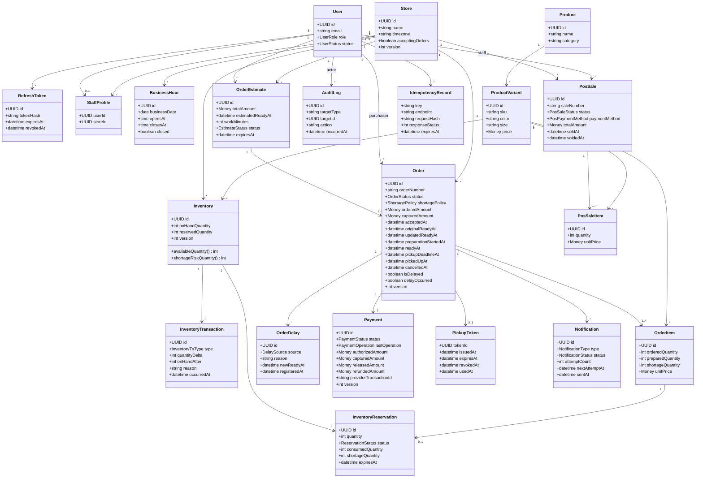

主な列挙値：

- `InventoryTxType`：INITIAL、RECEIVE、POS_SALE、POS_VOID、EC_PICKUP_OUT、EC_SHORTAGE、EC_CANCEL_RETURN、EC_EXPIRED_RETURN、STOCKTAKE、DAMAGE（10.4）
- `ReservationStatus`：HELD、CONFIRMED、SETTLED、RELEASED（7.4）
- `EstimateStatus`：HELD、USED、EXPIRED
- `DelaySource`：STAFF（店員が登録）、AUTO（予定超過による自動表示、J-01）
- `PosSaleStatus`：COMPLETED、VOIDED
- `PosPaymentMethod`：CASH、CARD、OTHER（記録のみ）

## 12. ER図

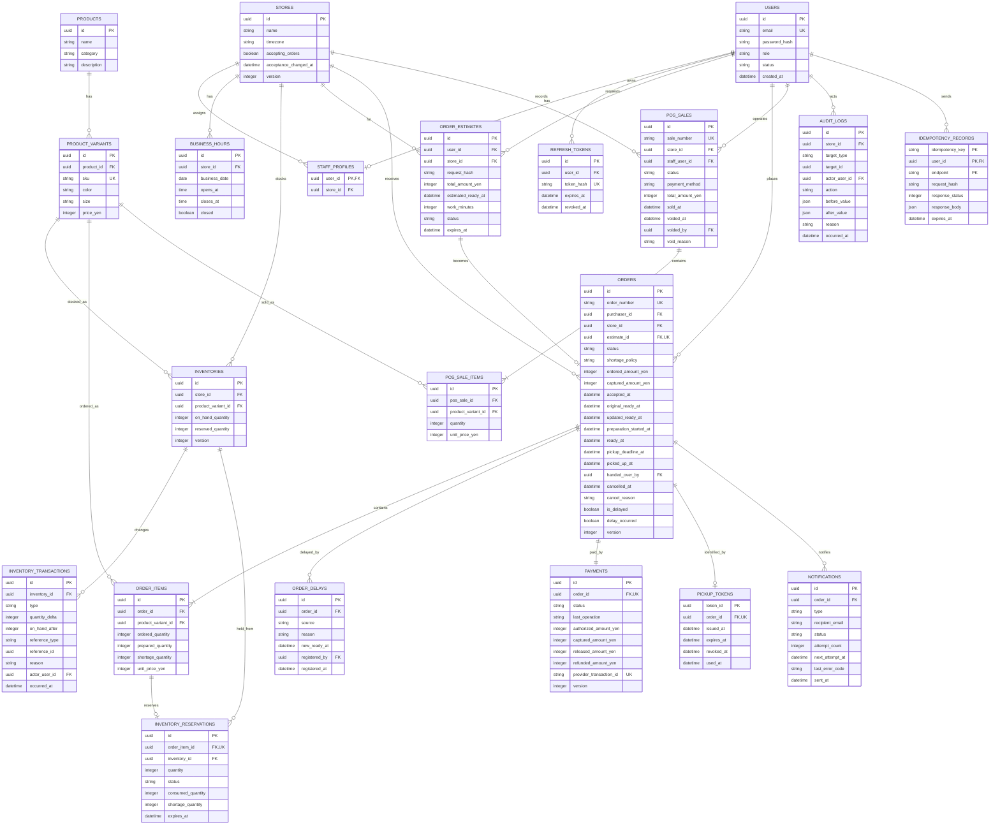

### 12.1 主なデータ制約

- 金額は日本円の整数で保存し、浮動小数点を使用しない。
- 数量（`ordered_quantity`、`prepared_quantity`、`shortage_quantity`、`on_hand_quantity`、`reserved_quantity` 等）は0以上の整数とする。
- 注文の数量合計は1〜10点とする。明細ごとに `prepared_quantity + shortage_quantity <= ordered_quantity` とする。
- `reserved_quantity <= on_hand_quantity` はDB制約にせず、新しい需要（EC仮確保・POS売上）に対してアプリケーションで検証する。欠品・棚卸・破損では下回ることを許し、欠品見込みとして表示する（10.5）。
- `on_hand_quantity` は在庫履歴（`INVENTORY_TRANSACTIONS.quantity_delta`）の合計と一致させる（J-07で確認）。
- 店舗と商品バリエーションの在庫は一意とする。
- 同じ外部決済取引IDを重複登録しない。
- 遅延の履歴は `ORDER_DELAYS` に追記し、上書きしない。`delay_occurred` は一度trueになったら戻さない。
- 監査履歴は注文以外（POS売上、在庫調整、受付状態）も対象とするため、対象種別と対象IDで記録する。
- QRは、サーバーの秘密鍵で署名したトークン（注文IDとトークンIDを含む）を表示のたびに生成し、DBにはトークンIDと失効・使用状況だけを保存する。QRの生値は保存しない。QRは受取期限を過ぎても、店員が商品を棚に戻すまで有効とする（T-05）。
- Idempotency-Keyは利用者・エンドポイントごとに一意とし、同じキーで異なる内容の要求が届いた場合は422で拒否する。
- 主要日時はタイムゾーン付きで保存し、表示時に店舗の日本時間へ変換する。

## 13. API設計

### 13.1 共通仕様

- 外部向けパスは `/api/v1` から始める。
- ブラウザはBFFのAPIを呼び、BFFがBackend APIへ転送する。決済Webhook（API-13）だけは決済サービスから届く。
- リクエスト・レスポンスはJSONを基本とする。
- IDはUUID形式、日時はISO 8601形式、金額は日本円整数とする。
- 作成・決済・取消・準備完了・受取確定・POS売上と取消・在庫の入荷と調整では `Idempotency-Key` を必須とする。同じキーの再送には最初の結果を返す（`IDEMPOTENCY_RECORDS`）。
- 一覧APIは `page` と `pageSize` を使用し、`pageSize` は1〜100とする。
- BackendはJWTの署名、期限、発行者、対象者、ロールを検証する。
- BackendはURL中の注文IDだけで所有者を判断せず、JWTの利用者IDと照合する。店員APIは、JWTの利用者に紐づく担当店舗と対象データの店舗が一致することを確認する。

### 13.2 API一覧

#### 認証・会員

| API ID | Method | Path | 認証 | 入力概要 | 出力概要 |
|---|---|---|---|---|---|
| API-01 | POST | `/api/v1/auth/register` | 不要 | email, password | 作成した利用者、認証結果。メール確認の要否はT-07 |
| API-02 | POST | `/api/v1/auth/login` | 不要 | email, password | 利用者、ロール、認証結果 |
| API-03 | POST | `/api/v1/auth/refresh` | Refresh token | なし | 更新された認証結果 |
| API-04 | POST | `/api/v1/auth/logout` | 必要 | なし | 処理結果 |

#### 店舗・商品（閲覧）

| API ID | Method | Path | 認証 | 入力概要 | 出力概要 |
|---|---|---|---|---|---|
| API-05 | GET | `/api/v1/stores` | 不要 | キーワード、日付 | 店舗、営業時間、受付状態、受付締切、最短の準備完了予定（参考値） |
| API-06 | GET | `/api/v1/stores/{storeId}/products` | 不要 | query, category, color, size, page | 商品一覧、在庫有無（販売可能数1以上） |
| API-07 | GET | `/api/v1/stores/{storeId}/products/{productId}` | 不要 | ID | 商品詳細、バリエーション、在庫有無 |

#### 購入者の注文

| API ID | Method | Path | 認証 | 入力概要 | 出力概要 |
|---|---|---|---|---|---|
| API-08 | POST | `/api/v1/orders/estimate` | 購入者 | 店舗、明細、欠品方針 | Backend計算値、受付可否、予定日時、estimateId、有効期限。作業枠を仮確保 |
| API-09 | POST | `/api/v1/orders` | 購入者 | estimateId、明細、Frontend表示値、支払方法参照 | 注文受付結果（201）、追加認証の情報または支払確認中（202） |
| API-10 | GET | `/api/v1/orders` | 購入者 | status, page | 自分の注文一覧 |
| API-11 | GET | `/api/v1/orders/{orderId}` | 購入者 | ID | 自分の注文詳細、遅延・欠品情報、QR表示可否、取消可否 |
| API-12 | POST | `/api/v1/orders/{orderId}/cancel` | 購入者 | reason, version | 取消結果、利用枠解放・返金状態 |
| API-13 | POST | `/api/v1/payments/webhook` | 決済サービスの署名 | 決済サービスのイベント | 受信結果。決済状態の更新はJ-03と共通処理 |

#### 店員：注文・受け取り

| API ID | Method | Path | 認証 | 入力概要 | 出力概要 |
|---|---|---|---|---|---|
| API-14 | GET | `/api/v1/staff/orders` | 店員 | status, page | 自店舗の注文一覧（遅延・欠品見込み・要対応を含む） |
| API-15 | POST | `/api/v1/staff/orders/{orderId}/preparation/start` | 店員 | version | 準備開始結果 |
| API-16 | POST | `/api/v1/staff/orders/{orderId}/shortages` | 店員 | 欠品明細、version | 欠品処理後の注文・金額。全体取消になった場合は取消結果 |
| API-17 | POST | `/api/v1/staff/orders/{orderId}/delay` | 店員 | reason, updatedReadyAt（確認中はnull）, version | 遅延情報 |
| API-18 | POST | `/api/v1/staff/orders/{orderId}/ready` | 店員 | version | 決済確定・準備完了結果 |
| API-19 | POST | `/api/v1/staff/pickups/verify` | 店員 | pickupCode | 引渡可否、理由、対象商品、照合ID |
| API-20 | POST | `/api/v1/staff/orders/{orderId}/handover` | 店員 | pickupVerificationId, version | 受取完了結果 |
| API-35 | POST | `/api/v1/staff/orders/{orderId}/return-to-stock` | 店員 | version | 期限切れ注文の商品を棚に戻した結果（EXPIRED_RETURNED、在庫更新） |

#### 店員：受付・営業時間

| API ID | Method | Path | 認証 | 入力概要 | 出力概要 |
|---|---|---|---|---|---|
| API-21 | GET | `/api/v1/staff/store` | 店員 | なし | 自店舗の受付状態、営業時間、休業日 |
| API-22 | PUT | `/api/v1/staff/store/acceptance` | 店員 | acceptingOrders, reason, version | 更新後の受付状態。停止中も既存注文の処理は継続 |
| API-23 | PUT | `/api/v1/staff/store/business-hours/{date}` | 店員 | opensAt, closesAt, closed, version | 更新後の営業時間。受付中の注文がある日の変更は警告 |

#### 店員：簡易POS

| API ID | Method | Path | 認証 | 入力概要 | 出力概要 |
|---|---|---|---|---|---|
| API-24 | GET | `/api/v1/staff/products` | 店員 | sku または query, page | 商品バリエーション、単価、自店舗の販売可能数 |
| API-25 | POST | `/api/v1/staff/pos/sales/estimate` | 店員 | 明細 | Backend計算額、明細ごとの販売可否（保存しない） |
| API-26 | POST | `/api/v1/staff/pos/sales` | 店員 | 明細、Frontend表示合計、支払区分 | 売上番号、在庫更新結果 |
| API-27 | GET | `/api/v1/staff/pos/sales` | 店員 | 日付、page | 自店舗の売上一覧・明細 |
| API-28 | POST | `/api/v1/staff/pos/sales/{saleId}/void` | 店員 | reason, version | 取消結果、戻した在庫 |

#### 店員：在庫

| API ID | Method | Path | 認証 | 入力概要 | 出力概要 |
|---|---|---|---|---|---|
| API-29 | GET | `/api/v1/staff/inventories` | 店員 | sku、商品名、欠品見込みのみ、page | 自店舗の在庫一覧（帳簿在庫、EC確保数、販売可能数、欠品見込み） |
| API-30 | GET | `/api/v1/staff/inventories/{inventoryId}/transactions` | 店員 | 期間、種別、page | 在庫履歴 |
| API-31 | POST | `/api/v1/staff/inventories/{inventoryId}/receipts` | 店員 | quantity, reason, version | 更新後在庫、履歴ID |
| API-32 | POST | `/api/v1/staff/inventories/{inventoryId}/adjustments` | 店員 | type（STOCKTAKE／DAMAGE）、countedQuantity または quantity、reason、version | 更新後在庫、差分、欠品見込み件数 |

在庫の数量を直接上書きするAPI（PATCH）は設けず、入荷・棚卸・破損の種類を指定した登録だけを受け付ける。

#### v1.1で追加したAPI

| API ID | Method | Path | 認証 | 入力概要 | 出力概要 |
|---|---|---|---|---|---|
| API-36 | POST | `/api/v1/orders/{orderId}/payment/refresh` | 購入者 | なし | 3Dセキュア後の支払結果を反映した注文状態 |
| API-37 | POST | `/api/v1/orders/{orderId}/pickup-token/reissue` | 購入者 | version | 新しいQR |
| API-38 | POST | `/internal/jobs/run` | ジョブ用の秘密ヘッダー | 実行するジョブ | 実行結果 |
| API-39 | GET | `/api/v1/dev/mails` | ログイン（開発用の設定が有効なときだけ） | page | 送信メール一覧 |
| API-40 | GET | `/api/v1/auth/me` | ログイン | なし | ログイン中の利用者 |
| API-41 | GET | `/api/v1/staff/orders/{orderId}` | 店員 | なし | 店員用の注文詳細と可能な操作 |

API-33・API-34（運営担当）は欠番とする。入出力の詳細とエラーは詳細設計書 02_API詳細に定める。

### 13.3 TypeScript型定義案

BackendはFastAPIのため、Backendが出力するOpenAPI定義からFrontend・BFFの型を生成し、同じ意味の項目を別々に手入力しない。本番ではOpenAPIの公開ルートを無効化する（16.6）ため、型生成は開発環境またはビルド時に行う。

```typescript
type UUID = string;
type ISODateTime = string;
type MoneyYen = number; // 0以上の整数。小数不可

type UserRole = "CUSTOMER" | "STAFF";
type ShortagePolicy = "CANCEL_ALL" | "PURCHASE_AVAILABLE";

type OrderStatus =
  | "PENDING_PAYMENT"
  | "NOT_ACCEPTED"
  | "RECEIVED"
  | "PREPARING"
  | "READY"
  | "ACTION_REQUIRED"
  | "PICKED_UP"
  | "CANCELLED"
  | "EXPIRED"
  | "EXPIRED_RETURNED";

type PaymentStatus =
  | "NOT_STARTED"
  | "AUTHORIZING"
  | "REQUIRES_ACTION"
  | "AUTHORIZED"
  | "CAPTURING"
  | "CAPTURED"
  | "RELEASING"
  | "RELEASED"
  | "REFUNDING"
  | "REFUNDED"
  | "FAILED"
  | "UNKNOWN";

type InventoryTxType =
  | "INITIAL"
  | "RECEIVE"
  | "POS_SALE"
  | "POS_VOID"
  | "EC_PICKUP_OUT"
  | "EC_SHORTAGE"
  | "EC_CANCEL_RETURN"
  | "EC_EXPIRED_RETURN"
  | "STOCKTAKE"
  | "DAMAGE";

interface OrderItemInput {
  productVariantId: UUID;
  quantity: number; // 1〜10。注文全体でも10以下
}

interface OrderEstimateRequest {
  storeId: UUID;
  items: OrderItemInput[];
  shortagePolicy: ShortagePolicy;
}

interface OrderEstimateResponse {
  estimateId: UUID;
  accepted: boolean;
  rejectionCode?: string; // 例：ORDER_CLOSED、CAPACITY_FULL、OUT_OF_STOCK
  totalQuantity: number;
  totalAmountYen: MoneyYen;
  estimatedReadyAt?: ISODateTime;
  pickupDeadlineRule: string; // 期限の数え方の表示文
  overduePolicyText: string; // 期限超過時の扱いの表示文（設定値）
  estimateExpiresAt: ISODateTime;
}

interface CreateOrderRequest extends OrderEstimateRequest {
  estimateId: UUID;
  clientTotalAmountYen: MoneyYen;
  clientEstimatedReadyAt: ISODateTime;
  paymentMethodReference: string; // 決済サービスが発行した参照ID。カード番号は含めない
  agreedToPickupTerms: true;
}

interface CreateOrderResponse {
  orderId: UUID;
  orderNumber: string;
  status: OrderStatus; // RECEIVED または PENDING_PAYMENT
  paymentStatus: PaymentStatus;
  paymentNextAction?: unknown; // 3Dセキュアの追加認証に必要な情報（決済サービス依存）
  originalReadyAt?: ISODateTime;
}

interface OrderItemView {
  productVariantId: UUID;
  productName: string;
  color: string;
  size: string;
  orderedQuantity: number;
  preparedQuantity?: number;
  shortageQuantity?: number;
  unitPriceYen: MoneyYen;
}

interface OrderDelayView {
  source: "STAFF" | "AUTO";
  reason: string;
  newReadyAt?: ISODateTime; // 未確定（確認中）は省略
  registeredAt: ISODateTime;
}

interface OrderResponse {
  orderId: UUID;
  orderNumber: string;
  status: OrderStatus;
  paymentStatus: PaymentStatus;
  storeId: UUID;
  storeName: string;
  items: OrderItemView[];
  totalQuantity: number;
  orderedAmountYen: MoneyYen;
  capturedAmountYen?: MoneyYen;
  acceptedAt?: ISODateTime;
  originalReadyAt?: ISODateTime;
  updatedReadyAt?: ISODateTime;
  readyAt?: ISODateTime;
  pickupDeadlineAt?: ISODateTime;
  isDelayed: boolean;
  delayOccurred: boolean;
  latestDelay?: OrderDelayView;
  canShowPickupCode: boolean; // READY・EXPIREDかつ決済確定済みのとき true（T-06）
  canCancel: boolean;
  version: number;
}

interface InventoryView {
  inventoryId: UUID;
  sku: string;
  productName: string;
  color: string;
  size: string;
  onHandQuantity: number;
  reservedQuantity: number;
  availableQuantity: number; // max(0, onHand - reserved)
  shortageRiskQuantity: number; // max(0, reserved - onHand)
  version: number;
}

interface InventoryAdjustmentRequest {
  type: "STOCKTAKE" | "DAMAGE";
  countedQuantity?: number; // STOCKTAKEのとき必須
  quantity?: number; // DAMAGEのとき必須。1以上
  reason: string;
  version: number;
}

interface PosSaleRequest {
  items: Array<{ productVariantId: UUID; quantity: number }>;
  clientTotalAmountYen: MoneyYen;
  paymentMethod: "CASH" | "CARD" | "OTHER";
}

interface ApiError {
  code: string;
  message: string;
  fieldErrors?: Array<{
    field: string;
    code: string;
    message: string;
  }>;
  traceId: string;
  latestResource?: unknown;
}
```

`number` 型だけでは整数・範囲を保証できないため、実行時の入力検証とBackendでの再検証を必須とする。

### 13.4 Frontend計算値とBackend計算値の照合

1. Frontendは利用者向けに数量と暫定合計を計算する。予定日時はFrontendで計算しない。
2. `API-08` がDB上の価格、在庫、営業時間、作業量から正式な見積もりを返し、作業枠を有効期限まで仮確保する。
3. Frontendは `estimateId`、表示した合計、表示した予定日時を注文要求（`API-09`）に含める。
4. Backendは注文受付時に再計算し、見積もりが有効期限内で本人・店舗・明細が一致すること（`request_hash`）を検証する。
5. 金額が一致しない場合、予定日時が許容幅（6.1）を超えて遅くなる場合、見積もりが期限切れの場合は注文を成立させず、`409 CALCULATION_CHANGED` と最新値を返す。
6. Frontendは差分を表示し、利用者に再確認を求める。

POSでも同じ方式を使い、`API-25` の見積もりと `API-26` の確定時の再計算を照合する。金額や在庫をFrontendの値で上書きすることは禁止する。Frontendの値は改ざん検知と利用者への差分説明にのみ利用する。

## 14. 入力項目と制約

| 項目 | 型 | 必須 | 制約 | 主なエラーコード |
|---|---|:---:|---|---|
| email | string | ○ | 前後空白除去、メール形式、最大254文字 | INVALID_EMAIL |
| password | string | ○ | 12〜128文字（その他の条件なし） | INVALID_PASSWORD |
| storeId | UUID | ○ | 存在し利用可能な店舗 | STORE_NOT_FOUND |
| productVariantId | UUID | ○ | 選択店舗で販売対象 | PRODUCT_NOT_FOUND |
| item.quantity | integer | ○ | 1〜10 | QUANTITY_OUT_OF_RANGE |
| order.totalQuantity | integer | ○ | 全明細合計1〜10 | ORDER_LIMIT_EXCEEDED |
| shortagePolicy | enum | ○ | CANCEL_ALL／PURCHASE_AVAILABLE | INVALID_SHORTAGE_POLICY |
| query | string | ― | 1〜100文字、制御文字不可 | INVALID_QUERY |
| page | integer | ― | 1以上、既定1 | INVALID_PAGE |
| pageSize | integer | ― | 1〜100、既定20 | INVALID_PAGE_SIZE |
| delay.reason | string | ○ | 1〜200文字 | DELAY_REASON_REQUIRED |
| updatedReadyAt | ISODateTime/null | 条件付 | 店舗時刻として妥当。未確定時はnull | INVALID_READY_TIME |
| cancel.reason | string | ○ | 定義済みコード＋補足最大200文字 | INVALID_CANCEL_REASON |
| pickupCode | string | ○ | 長さ・文字種・署名を検証し、トークンが失効・使用済みでないこと | INVALID_PICKUP_CODE |
| estimateId | UUID | ○ | 本人・店舗・明細が一致し有効期限内 | ESTIMATE_EXPIRED／CALCULATION_CHANGED |
| agreedToPickupTerms | boolean | ○ | true（受取期限・期限超過時の扱いを確認済み） | TERMS_NOT_AGREED |
| sku | string | 条件付 | 1〜32文字、英大文字・数字・`-` のみ（小文字は大文字に変換） | INVALID_SKU |
| pos.item.quantity | integer | ○ | 1〜99（提案）、販売可能数以内 | QUANTITY_OUT_OF_RANGE／INSUFFICIENT_STOCK |
| pos.paymentMethod | enum | ○ | CASH／CARD／OTHER | INVALID_PAYMENT_METHOD |
| pos.void.reason | string | ○ | 1〜200文字 | VOID_REASON_REQUIRED |
| receipt.quantity | integer | ○ | 1〜9,999（提案） | INVALID_INVENTORY |
| adjustment.type | enum | ○ | STOCKTAKE／DAMAGE | INVALID_ADJUSTMENT_TYPE |
| adjustment.countedQuantity | integer | 条件付 | STOCKTAKEで必須。0〜99,999（提案） | INVALID_INVENTORY |
| adjustment.quantity | integer | 条件付 | DAMAGEで必須。1以上、帳簿在庫以下 | INVALID_INVENTORY／INSUFFICIENT_STOCK |
| adjustment.reason | string | 条件付 | 減少・差分ありの場合必須。1〜200文字 | ADJUSTMENT_REASON_REQUIRED |
| acceptance.reason | string | 条件付 | 受付停止時は必須。1〜200文字 | ACCEPTANCE_REASON_REQUIRED |
| businessHours | time | ○ | 開店 < 閉店、同一営業日内 | INVALID_BUSINESS_HOURS |
| clientTotalAmountYen | integer | ○ | 0以上。Backend計算値との一致が必要 | CALCULATION_CHANGED |
| version | integer | ○ | 0以上、DBの現在値と一致 | CONFLICTING_UPDATE |
| Idempotency-Key | string（ヘッダー） | 条件付 | UUID形式。同じキーで異なる内容の要求は拒否 | IDEMPOTENCY_KEY_REUSED |

数量の上限（POS明細、入荷、棚卸）は提案値であり、テストデータの規模と合わせて確定する。

文字列長や数量上限はFrontendとBackendの両方で検証する。最終判断はBackendとし、DB制約でも矛盾した値を拒否する。

## 15. エラー処理

### 15.1 HTTPステータスの使い分け

| Status | 用途 | 例 |
|---|---|---|
| 400 | JSON形式や型が不正 | UUID形式不正、必須項目不足 |
| 401 | 未認証またはJWT無効 | 期限切れ、署名不正 |
| 403 | 認証済みだが権限なし | 購入者が店員APIを操作 |
| 404 | 対象がない、または存在を隠す | 他人の注文IDへのアクセス |
| 202 | 処理は受け付けたが結果が未確定 | 3Dセキュアの追加認証中、決済結果の確認中 |
| 409 | 現在状態との競合 | 価格変更、在庫競合、見積もり期限切れ、二重受取、POSでの販売可能数不足、version不一致 |
| 422 | 業務条件を満たさない | 10点超過、受付締切、受付停止中、決済拒否、取消条件を満たさない |
| 429 | 試行回数超過 | ログイン・QR照合の過剰試行 |
| 500 | アプリ内部エラー | 予期しない処理失敗 |
| 502/503 | 外部サービス利用不能 | 決済・メールサービス障害 |

### 15.2 画面での扱い

- 入力エラーは対象項目の近くに表示し、入力内容を可能な限り保持する。
- 価格・在庫・予定時刻の変更は一般的なエラーにせず、変更前後を示して再確認できるようにする。
- 決済結果不明では「失敗」と断定せず、「処理結果を確認中」と表示し、重ねて注文させない。注文詳細（C-10）で結果を確認できるようにする。
- POSで販売可能数が足りない場合は、不足している明細と理由（在庫不足／EC注文で確保中）を明細の横に表示する。
- 認証期限切れ後は再ログインさせ、可能なら元の画面へ戻す。
- 画面には内部例外、SQL、スタックトレース、秘密情報を表示しない。
- `traceId` を問い合わせ用に表示し、個人情報を含まないログと対応付ける。

## 16. セキュリティ設計

### 16.1 認証・JWT

- ログイン成功後に署名済みJWTを使用する。
- パスワードは平文で保存せず、Argon2idまたはbcrypt等のパスワード向けハッシュ関数と個別saltを使用する。採用方式とパラメータは技術選定後に確定する。
- ログイン失敗時は、メールアドレスの登録有無を判別しにくい共通メッセージを表示する。
- ログイン、トークン更新、QR照合には回数制限を設け、総当たり試行を抑制する。
- JWTには利用者ID、ロール、発行時刻、失効時刻、発行者、対象者、トークンIDを含める案とする。
- アクセストークンをブラウザのLocalStorageへ保存しない。
- BFF構成では `HttpOnly`、`Secure`、`SameSite` 属性付きCookieまたはBFF側セッションで扱い、JavaScriptから直接読めないようにする。
- アクセストークン15分、リフレッシュトークン7日を初期提案とし、運用・セキュリティ要件に合わせて確定する。
- リフレッシュトークンはローテーションし、サーバーには失効確認用のハッシュまたはトークンIDを保存する案とする。
- ログアウト時はCookie削除だけでなく、リフレッシュトークンを失効させる。

### 16.2 認可

- 画面の表示制御だけでなく、すべてのBackend APIでロールと対象データを検証する。
- 購入者の注文取得・取消では `order.purchaserId == jwt.subject` を確認する。
- 店員操作では、店員の担当店舗と注文・在庫の店舗が一致することを確認する。
- QR所持だけでは注文履歴APIや取消APIを利用できない。
- 運営担当のロールは作らない。障害対応はサーバー上の管理コマンドで行い、アプリのAPIからは実行できない。
- 在庫調整・POS売上取消は、操作者と理由を監査履歴へ必ず記録する。

#### 16.2.1 QRコード

- QRには、サーバーの秘密鍵で署名したトークン（注文ID、トークンID、発行日時）を入れる。氏名・メールアドレス・カード情報は含めない（S-02）。
- 注文詳細を開くたびに同じトークンIDで署名し直して表示する。DBにはトークンIDと失効・使用状況だけを保存し、QRの生値は保存しない。
- 照合時は署名とトークンの状態に加え、最新の注文状態（自店舗・READY・決済確定済み・未取消・未受取）で引き渡し可否を判断する。
- 紛失・流出時は、購入者が注文詳細からQRを再発行できる。再発行すると旧トークンIDは失効する（T-06）。
- カメラで読めない場合は、注文番号と6桁の受取コード（QRと並べて表示）を店員が手入力する（BD-T05、決定）。手入力の失敗は店員1人あたり10分間に5回までとし、注文番号と組み合わせることで推測されにくさを補う。

#### 16.2.2 決済Webhook

- 決済サービスが提供する署名を検証し、失敗した要求は処理しない。
- 同じイベントが複数回届いても結果が変わらないよう、イベントIDで重複を除く。
- Webhookの内容だけで状態を確定せず、必要に応じて決済サービスへ照会してから更新する。

### 16.3 CORS・CSRF・BFF

- ブラウザからBFFへの通信を同一オリジンにそろえる。
- BackendのCORS許可元はBFFだけとし、ワイルドカードを使用しない。
- Cookie認証を使用する変更系APIでは、SameSite設定に加え、CSRFトークンまたはOrigin検証を行う。
- BFFは任意URLへ転送する汎用プロキシにせず、定義済みBackendエンドポイントだけへ転送する。
- 転送時に不要なCookie、クライアント指定の権限ヘッダー、内部ヘッダーを除去する。

### 16.4 SQLインジェクション対策

- DBアクセスはORMまたはパラメータ化クエリを使用する。
- 利用者入力をSQL文字列へ連結しない。
- 並び替え対象や列名は許可リストから選び、入力文字列をそのままSQL識別子にしない。
- Raw SQLが必要な場合は理由を記録し、バインド変数を使用してレビュー対象とする。
- DBユーザーの権限をアプリに必要な範囲へ限定する。

### 16.5 XSS・入力・出力

- 利用者入力をHTMLとして直接描画しない。
- フレームワークの自動エスケープを無効にする箇所は個別レビューする。
- Content Security Policy、`X-Content-Type-Options`、フレーム埋め込み制御などのHTTPヘッダーを設定する。
- MIMEタイプ、文字数、列挙値、数値範囲をFrontendとBackendで検証する。

### 16.6 Swagger／OpenAPI

- OpenAPI定義は型生成と開発時の確認に利用する。
- 本番環境ではSwagger UIとOpenAPI JSONの公開ルートを無効化する。
- 開発・テスト環境で公開する場合も、社内・開発ネットワークまたは認証で制限する。
- 環境変数だけでなく、デプロイ時テストで本番URLが404になることを確認する。

### 16.7 秘密情報・ログ

- APIキー、JWT署名鍵、DB接続情報をソースコードや公開リポジトリへ保存しない。
- カード番号、セキュリティコードをアプリのDB・ログへ保存しない。
- 有効なJWT、Refresh token、QRの生値、パスワード、メール本文をログへ出力しない。
- ログには日時、traceId、処理種別、結果、必要最小限の内部IDを記録する。

### 16.8 脆弱性・バージョン管理

| 項目 | 設計方針 |
|---|---|
| バージョン選定 | 公式にサポート中の安定版またはLTSを候補にし、Azureと依存パッケージとの互換性を確認 |
| 記録 | Frontend、Backend、Runtime、ORM、RDB、主要OSSの採用版、調査日、公式サポート期限、選定理由を一覧化 |
| 固定 | ロックファイルをコミットし、再現可能なインストールを行う |
| 検査 | 依存関係の脆弱性検査を導入し、リリース前と依存更新時に実行 |
| 対応 | Critical／Highは原則解消。解消できない場合は影響、回避策、期限を記録 |
| 更新 | メジャー版を自動更新せず、テスト後に更新。直接依存だけでなく間接依存も確認 |

### 16.9 技術選定・バージョン調査表

調査日：2026年9月13日（再確認：2026年10月31日）。**実装で使う版は詳細設計書 00_実装ガイド 2章を正とする**（FastAPI 0.162系、SQLAlchemy 2.0系、Next.js 16.4系、Node 24 LTS、Python 3.12 など）。下の表は選定の経緯として残す。

| 技術 | 採用候補 | 状態・理由 | 2026年10月31日の再確認 |
|---|---|---|---|
| Next.js | 16.x | Active LTS。App RouterとTypeScriptを使用 | 16.xはActive LTSのまま。15.xはMaintenance LTSで、セキュリティ修正は2027年1月31日まで |
| Node.js | Next.js 16の対応LTS | Next.jsの必要条件とAzure App Serviceの提供Runtimeを実装開始時に照合 | ― |
| FastAPI | 0.141.x | 公式リリースノート上の安定系列。パッチ版を固定 | 2026年10月23日に0.162.0が公開済み。実装開始時に系列を選び直し、変更点を確認してから固定する |
| Python | Azure App Service対応安定版 | FastAPI、SQLAlchemy、ドライバーの対応を照合して固定 | ― |
| SQLAlchemy | 2.0.x | 型サポートのある現行安定系列。2026年9月13日時点の公式掲載は2.0.52 | 2.1系が正式公開され、2.0系はメンテナンス版（2.0.55）。公式は未検証なら2.0系に固定するよう案内しているため、2.0系に固定し、2.1系へは検証後に移行する |
| Alembic | SQLAlchemy 2.0互換安定版 | DBマイグレーション管理に使用 | ― |
| MySQL | 17 | 課題の提供環境に合わせたLTS版。Azureの版サポートポリシーで確認する | ― |
| Azure DB | Azure Database for MySQL Flexible Server | バックアップ、保守、停止・開始等をAzure側で管理できるマネージドDB | ― |
| Hosting | Azure App Service | Next.jsとFastAPIを別アプリとして配置する初期案 | ― |

参考：

- [Next.js Support Policy](https://nextjs.org/support-policy)
- [FastAPI Release Notes](https://fastapi.tiangolo.com/release-notes/)
- [SQLAlchemy 2.0 Documentation](https://docs.sqlalchemy.org/en/20/)
- [SQLAlchemy 2.1.0rc2 Released（SQLAlchemy公式ブログ、2.0系の固定に関する案内を含む）](https://www.sqlalchemy.org/blog/2026/09/08/sqlalchemy-2.1.0rc2-released/)
- [Azure Database for MySQL version policy](https://learn.microsoft.com/en-us/azure/mysql/concepts-version-policy)
- [Azure Database for MySQLのTLS接続](https://learn.microsoft.com/en-us/azure/mysql/flexible-server/security-tls-how-to-connect)
- [「クレジットカード・セキュリティガイドライン」改訂、2025年3月末までのEMV 3-Dセキュア導入（ScanNetSecurity）](https://scan.netsecurity.ne.jp/article/2024/03/25/50756.html)：決済で3Dセキュアを前提にする根拠

## 17. 非機能・運用設計

| ID | 項目 | 初期方針 | 確認方法 |
|---|---|---|---|
| BD-N01 | 操作性 | スマートフォン幅で購入・状況確認を完了可能。予定時刻・金額・店舗・状態を、色だけに頼らず文字で確認できる（N-01）。店員画面は店舗端末の幅でもPOS・在庫操作を完了可能 | 主要画面を実機相当幅で操作 |
| BD-N02 | 性能 | アプリ起動済みの状態で主要APIが2秒以内（シードデータ。T-08） | 商品検索、注文確認、QR照合、POS売上確定を測定 |
| BD-N03 | 整合性 | 在庫・注文・決済・受取・POS売上の更新にトランザクション、行ロック、冪等性を使用 | 同時注文、EC×POSの同時操作、二重送信、同時受取試験 |
| BD-N04 | 復旧性 | 外部処理の失敗・結果不明を記録し、定期処理で照合可能 | 決済タイムアウトと再照合試験 |
| BD-N05 | 可用性 | 受付停止中でも既存注文の状態確認・準備・引き渡し、POS・在庫操作を可能とする案 | 受付停止状態で確認 |
| BD-N06 | 監査 | 重要操作（欠品、遅延、取消、引渡、受付停止、POS売上・取消、入荷・在庫調整）の操作者、日時、変更内容、理由を記録 | 各操作の監査履歴を確認 |
| BD-N07 | バックアップ | 注文・決済・在庫・在庫履歴の対応を復元できる方式を採用 | 復元手順のリハーサル |
| BD-N08 | デモ | テスト用店舗・商品・在庫・会員・店員・注文・POS売上を初期化可能 | デモ前の初期化確認 |
| BD-N09 | 在庫の整合 | 帳簿在庫と在庫履歴の合計、EC確保数と有効な確保の合計を毎日照合（J-07） | 差異を意図的に作り、検出されることを確認 |
| BD-N10 | 定期処理 | 定期処理は多重起動せず、停止しても再開後に取りこぼしなく処理する | 定期処理を止めて再開し、期限・遅延・照合が正しく反映されることを確認 |

## 18. 主要テスト観点

| テストID | 観点 | 期待結果 |
|---|---|---|
| BT-01 | 10点と11点の注文 | 10点は他条件を満たせば受付可能、11点はFrontend・Backend双方で拒否 |
| BT-02 | Frontend金額の改ざん | Backendが再計算し、不一致なら注文を成立させない |
| BT-03 | 最後の在庫へのEC・POS同時操作 | 一方だけ成立し、販売可能数・帳簿在庫が負数にならない |
| BT-04 | 注文作成の二重送信 | 同じIdempotency-Keyでは1注文・1利用枠確保だけ成立 |
| BT-05 | 決済タイムアウト | 失敗と断定せずUNKNOWNとして照合し、二重確定しない |
| BT-06 | 他人の注文ID指定 | 詳細閲覧・取消を拒否し、情報を返さない |
| BT-07 | 他店舗の店員操作 | 準備、欠品、遅延、引き渡しを拒否 |
| BT-08 | QRコピーの同時提示 | 受取完了は1回だけ成立 |
| BT-09 | SQL注入文字列 | SQLとして実行されず、検索文字列または入力エラーとして処理 |
| BT-10 | JWT改ざん・期限切れ | 401で拒否 |
| BT-11 | CORS不許可オリジン | ブラウザからの通信を許可しない |
| BT-12 | 本番Swagger URL | Swagger UIとOpenAPI JSONを取得できない |
| BT-13 | 一部欠品 | 一部購入では用意できた金額のみ確定して残りの利用枠を解放する。欠品分は帳簿在庫から減算され、販売可能数に戻らない |
| BT-14 | 遅延取消 | 受取前に取消可能で、決済状態に応じて解放または返金される。READY後の取消では商品が帳簿在庫に戻る |
| BT-15 | 見積もりの期限・予定のずれ | 有効期限内で予定のずれが許容幅以内なら表示した予定で受付。期限切れ・許容幅超過では409で最新値を表示 |
| BT-16 | 在庫仮確保後の利用枠確保失敗 | 注文はNOT_ACCEPTEDになり、仮確保した在庫と作業枠が解放される |
| BT-17 | 3Dセキュア | 認証成功でRECEIVED。認証を中断した場合は仮確保期限後に照合してNOT_ACCEPTEDになり、在庫が解放される |
| BT-18 | 予定超過の自動遅延 | 予定を過ぎた未完了の注文が遅延表示になり、遅延メールが送信待ちに登録される。遅延解消後のREADYでも取消できる |
| BT-19 | 遅延のない注文の取消 | 購入者の取消を拒否する（T-03：初期実装では利用者都合の取消を設けない） |
| BT-20 | 取消と引き渡しの同時操作 | どちらか一方だけが成立し、決済・在庫が矛盾しない |
| BT-21 | 受付締切の境界 | 21時閉店の店舗で20:00:00の注文要求は受付可、20:00:01以降は受付不可 |
| BT-22 | 受取期限の表示 | 9月7日準備完了・9月14日通常営業の例で、9月14日の閉店時刻が期限として表示される |
| BT-23 | メール送信失敗 | 準備完了などの業務状態は維持され、再送される。上限到達でFAILEDとなり、管理コマンドで確認・再送できる |
| BT-24 | QRの再表示・失効 | 注文詳細を開き直しても照合できる。失効・使用済み・署名不正のQRは拒否される |
| BT-25 | POS売上の二重送信 | 同じIdempotency-Keyでは1売上・1回の在庫減算だけ成立 |
| BT-26 | EC確保済み商品のPOS販売 | 販売可能数を超える売上は拒否され、理由（EC注文で確保中）が表示される |
| BT-27 | 棚卸で帳簿在庫が確保数を下回る | 調整は記録され、欠品見込みが在庫一覧・注文一覧に表示される。新規のEC注文・POS販売は成立しない |
| BT-28 | POS売上取消 | 在庫が戻り、在庫履歴と監査履歴が残る。同じ売上を二重に取り消せない |
| BT-29 | 在庫履歴の整合 | 一連の入荷・販売・EC出庫・欠品・調整の後、帳簿在庫と在庫履歴の合計が一致する |
| BT-30 | 他店舗のPOS・在庫操作 | 他店舗の在庫照会・入荷・調整・売上登録を拒否する |
| BT-31 | 受付停止 | 停止中は新規見積もり・注文を422で拒否し、既存注文の準備・引き渡しとPOSは継続できる |
| BT-32 | 決済Webhook | 署名不正は拒否、同じイベントの重複は1回だけ反映される |
| BT-33 | 予定時刻の計算 | 先行作業なし・10点で45分後。予定が60分を超える、または閉店15分前を超える場合は受付不可（7.7の例） |
| BT-34 | 休業日の受取期限 | 準備完了日の1週間後が休業日なら、次の営業日の閉店時刻が期限として表示される |
| BT-35 | 期限切れ後の引き渡し・棚戻し | 期限切れでも棚に戻す前はQRで引き渡せる。棚に戻すと在庫が戻り、以後のQRは拒否される。返金は行われない |

## 19. トレーサビリティ

テスト欄の `A-xx` は要件定義書6章の受け入れ確認項目、`BT-xx` は本書18章のテスト観点を指す。

| 要求・要件 | 主な設計 | 主な画面 | 主なAPI・定期処理 | テスト |
|---|---|---|---|---|
| R-01／F-01・F-02 | 店舗別商品検索 | C-01〜C-03 | API-05〜07 | A-01 |
| R-02／F-02 | 商品詳細、色・サイズ・数量の選択、カート | C-03・C-04 | API-07 | A-01、BT-01 |
| R-03／F-04〜F-06 | 見積もり、予定時刻の計算（7.7）、作業枠の仮確保、受付判定 | C-04〜C-08 | API-05・08・09 | A-03・A-04、BT-02・15・21・33 |
| R-04／F-03・F-05・F-07 | 数量、在庫、作業枠、受付停止 | C-04・ST-02・ST-03・ST-13 | API-08・09・14・15・22 | A-02、BT-01・03・31 |
| R-05／F-06・F-09 | 在庫仮確保後の利用枠確保、3Dセキュア、決済確定 | C-07・C-08・ST-03 | API-09・13・18、J-02・J-03 | A-05・A-11、BT-04・05・16・17 |
| R-06／F-08・F-09 | 欠品方針、欠品分の帳簿在庫減算 | C-06・ST-04 | API-16・18 | A-05、BT-13 |
| R-07／F-10・F-11 | 遅延、予定超過の自動遅延、遅延後の取消 | C-10・C-11・ST-02・ST-05 | API-11・12・17、J-01 | A-06・A-17、BT-14・18・19・20 |
| R-07／F-12・F-13 | 注文詳細、メール通知（送信待ち・再送） | C-10 | API-11、J-04 | A-09、BT-23 |
| R-08／F-14・F-15・F-18 | 署名付きQR、一回限りの引渡 | C-10・ST-06・ST-07 | API-19・20 | A-07・A-11、BT-08・20・24 |
| R-09／F-16 | 受取期限（休業日の延長）、期限超過、棚戻し | C-06・C-10・ST-02 | API-08・11・35、J-05 | A-10・A-16、BT-22・34・35 |
| R-10／F-17・F-18 | 会員登録、ログイン、権限 | C-05・ST-01 | API-01〜04、保護API全般 | A-08、BT-06・07・10・30 |
| O-01／F-19 | 受付停止・営業時間 | ST-02・ST-13 | API-21〜23 | BT-31 |
| O-02 | 在庫履歴、入荷・棚卸・破損 | ST-10〜ST-12 | API-29〜32、J-07 | BT-27・29 |
| O-03／N-04 | 失敗・結果不明の照合と再処理 | 管理コマンド | API-13・36・38、J-02〜J-04 | BT-05・17・23・32 |
| O-05 | 監査履歴 | 店員画面全般 | 変更系API全般 | BT-28 |
| SC-01 | UML（ユースケース、アクティビティ、状態、シーケンス、クラス） | ― | ― | ― |
| SC-02 | JWT・認証・認可 | C-05・ST-01 | API-01〜04、保護API全般 | BT-06・07・10 |
| SC-03／F-20〜F-22 | 簡易POS・共通在庫・在庫履歴 | ST-08〜ST-12 | API-24〜32 | A-13〜A-15、BT-03・25〜29 |
| SC-04 | BFF・CORS | 全画面 | 全API | BT-11 |
| SC-05 | Backend再計算 | C-06・ST-08 | API-08・09・25・26 | BT-02・15 |
| SC-06 | 本番Swagger非表示 | ― | API文書ルート | BT-12 |
| SC-07〜10 | 入力・ORM・型・脆弱性対策 | 全画面 | 全API | BT-09、セキュリティ試験 |
| SC-11 | 入力制約・エラー処理 | 全画面 | 全API（14・15章） | BT-01・09 |
| SC-12 | API一覧・入出力・型 | ― | 13章 | ― |
| SC-13 | ER図 | ― | 12章 | BT-29 |

## 20. 未決定事項と決定事項

### 20.1 要件定義書の未決定事項（T-01〜T-09）の状況

| ID | 項目 | 状況 | 基本設計での扱い |
|---|---|---|---|
| T-01 | 準備時間・混雑・閉店判定 | 決定 | AI案の計算式を採用（7.7）。締切は閉店1時間前ちょうどまで受付可 |
| T-02 | 在庫・作業枠の確保 | 決定 | 仮確保→利用枠確保→確定の順（6.1）、作業枠は店舗行ロックで直列化（9.1）、店頭の在庫変動は簡易POS・入荷・棚卸で反映（10章）、期限はBD-T13 |
| T-03 | 利用者都合の取消 | 決定 | 初期実装では設けない。購入者が取り消せるのは店舗都合の遅延が発生した注文だけ（7.2） |
| T-04 | 支払い・状態遷移 | 決定 | Stripeのテスト環境（2.2）。状態遷移は7.2・7.3 |
| T-05 | 休業日・期限超過 | 決定 | 休業日は次の営業日の閉店まで延長。期限切れは棚に戻すまで引き渡し可、棚に戻したら終了・返金なし（7.2） |
| T-06 | ログイン・QR | 決定 | JWTはBD-T03。QRはREADYから表示し、購入者が再発行できる（旧QRは無効）。カメラで読めない場合は注文番号＋6桁の受取コードを手入力（BD-T05） |
| T-07 | 通知 | 決定 | 既定は送信せずDBに保存し、DEV-01で確認する。SMTPの設定時だけ実送信。会員登録時のメール確認なし。再送は最大5回 |
| T-08 | 非機能の具体値 | 決定 | 対象はiPhone Safari・Android Chrome・PC Chromeの最新版。性能試験専用データ（3店舗・100商品・1,000 SKU。日常シードは少量構成）で主要APIが起動済みの状態で2秒以内。保存期間と復旧目標は定めず、バックアップはDBの自動バックアップ（7日）に任せる |
| T-09 | 価格・商品条件 | 決定 | 税込価格のみ表示し、税の内訳は出さない。絞り込みはキーワード・カテゴリ・色・サイズ、並び順は新着・価格の安い順・高い順。値引き・手数料なし |

### 20.2 基本設計で決定した項目

プロジェクトオーナーが2026年10月31日に確認し、決定とした。BD-T09は取り下げた（開発計画は作成しない）。

| ID | 項目 | 決定内容 |
|---|---|---|
| BD-T01 | Azureの構成 | FrontendとBackendのソースコードを分け、別々のApp Service（Free F1）へデプロイする。MySQLは課題で提供された共有サーバー。Key Vault・Application Insightsは使わない。定期処理は常駐させない（3.4・7.6） |
| BD-T02 | POSの業務範囲 | 10.2の対象内（売上登録・当日取消・在庫連動）とし、返品・現金管理・レシート・値引き・カード端末連携は対象外 |
| BD-T03 | JWTの保存方式・有効時間 | BFF＋HttpOnly Cookie、アクセストークン15分、リフレッシュトークン7日 |
| BD-T04 | Backendの公開方法 | BFFとの共有秘密ヘッダーがある要求だけを受け付ける。例外はStripe Webhook、ジョブ実行API、ヘルスチェック（3.3） |
| BD-T05 | QR読取不能時の代替 | 注文番号＋6桁の受取コードの手入力（16.2.1） |
| BD-T06 | 運営担当画面 | 作らない。障害対応は管理コマンド |
| BD-T07 | 画面デザイン | 仮称「Pickup App」。GUのロゴ・商品画像は使わず、商品画像は単色の仮画像。配色などは詳細設計書 04_画面詳細 |
| BD-T08 | バージョン | 詳細設計書 00_実装ガイド 2章で固定 |
| BD-T10 | 在庫調整の権限 | 店員全員が理由を必須として登録でき、監査履歴に残す |
| BD-T11 | POSでのEC確保分の販売 | EC確保分を上書きしてPOS販売を優先する機能は設けない（10.5） |
| BD-T12 | 商品・価格マスタの登録 | 管理画面は作らず、シードデータまたはCSV取込で登録する |
| BD-T13 | 見積もり・仮確保の時間 | 見積もりの有効期限10分、在庫の仮確保15分（3Dセキュアを含む）、予定日時の許容幅5分 |
| ― | 稼働範囲 | 本番稼働はしない。テスト環境での構築・試験までとする（1.3） |

未決定事項は残っていない。

## 21. 詳細設計書

詳細設計書は `gu-docs/04_詳細設計/` に置いた。

| 文書 | 内容 |
|---|---|
| [00_実装ガイド](./04_詳細設計/00_実装ガイド.md) | 技術スタックと版、フォルダ構成、実装の順番と完了条件、実装の約束 |
| [01_DB設計](./04_詳細設計/01_DB設計.md) | 全テーブルの列・型・制約・インデックス、列挙値、初期データ |
| [02_API詳細](./04_詳細設計/02_API詳細.md) | 全APIの入出力、エラーコード、BFF |
| [03_業務ロジック](./04_詳細設計/03_業務ロジック.md) | 計算式、状態遷移表、決済、在庫、遅延、QR、メール、ジョブ、冪等性 |
| [04_画面詳細](./04_詳細設計/04_画面詳細.md) | 全画面の表示・操作・文言、デザイン |
| [05_インフラ・設定](./04_詳細設計/05_インフラ・設定.md) | Azure、環境変数、デプロイ、Stripe、ローカル環境 |

テストは詳細設計とは別文書の[05_テスト仕様書](./05_テスト仕様書.md)に記載する。要求・要件との対応、正常値・異常値・境界値、単体（FrontendはJest／Backendはpytest）・結合・機能・ユーザーテスト、実施・判定方法を扱う。

## 22. AI駆動開発での利用方法

本書は、AIへの一括指示ではなく、機能単位の実装根拠として使用する。

1. 要求・要件IDを選ぶ。
2. 対応する画面、API、状態、データ、テストIDを本書から抜き出す。
3. 未決定事項が残っていないか確認する。
4. AIに「実装」「テスト」「設計との差分確認」を同じ単位で依頼する。
5. AIの提案を自動的に合意済みとせず、重要な業務ルールとセキュリティ設定をプロジェクトオーナーが確認する。
6. 実装で設計変更が必要になった場合、コードだけでなく本書と要件定義書を更新する。

例1：注文受付を実装する場合は、R-03、F-04〜F-06、要件定義書UC-02、BUC03〜05、C-06〜C-08、API-08・09・13、6.1・7.2〜7.4、9.1、J-02・J-03、BT-02・04・05・15〜17を一組としてAIへ渡す。

例2：簡易POSを実装する場合は、SC-03、O-02、BUC12・13、ST-08〜ST-12、API-24〜32、6.4・6.5、9.4、10章、J-07、BT-03・25〜30を一組としてAIへ渡す。

## 23. レビュー記録

本書は要求・要件および追加された設計条件を基にAIが作成したものであり、実装やテストを実施済みと示すものではない。合意済みの業務方針は既存文書から引き継ぎ、Azureの詳細構成、POSの範囲、JWT設定、未決定の業務ルールは提案または未決定として区別した。

| 版 | 日付 | 内容 |
|---|---|---|
| 0.2 | 2026年9月13日 | レビュー用初稿 |
| 0.3 | 2026年10月31日 | 要求・要件定義書との照合レビューを反映。主な変更：注文受付を「在庫仮確保→利用枠確保→確定」に変更しPENDING_PAYMENT・NOT_ACCEPTEDを追加、見積もりによる作業枠の仮確保と予定日時の許容幅、実績・遅延・受付番号等の列とORDER_DELAYS等のテーブルを追加、遅延発生済み注文の取消条件を要件に合わせて修正、欠品分を帳簿在庫から減算、定期処理（J-01〜J-07）を追加、署名付きQRに変更、3Dセキュア・決済Webhook・通知の非同期送信を追加、会員登録・受付停止・営業時間のAPIと画面を追加、権限表の運営担当を照会・障害対応に限定、店員画面IDをST-xx・ユースケースIDをBUC-xxへ変更、技術構成の状態表記を修正。簡易POSと在庫管理を必須範囲とし、在庫履歴、入荷・棚卸・破損、POS売上取消、EC注文との整合ルールを設計（プロジェクトオーナー判断）。同日、設計条件SC-01〜13の出典を記入し、BD-T09（開発計画）を取り下げ、BD-T10〜13を決定 |
| 1.0 | 2026年10月31日 | 確定版。T-01（予定時刻の計算）、T-02、T-03（利用者都合の取消は設けない）、T-04（Stripeテストモード）、T-05（休業日の延長、期限切れ品の棚戻し）、BD-T01（配置・定期処理）、BD-T02、BD-T03を決定。配置とソースコード構成（3.4）、予定時刻の計算（7.7）、EXPIRED_RETURNED・API-35・BT-33〜35を追加。本番稼働しない前提を明記。要件定義書v0.3と整合 |
| 1.1 | 2026年10月31日 | 詳細設計書を作成し、残りの未決定事項（T-06〜T-09、BD-T01・04〜08）を決定。Azure Free（F1）前提で定期処理を常駐させない方式に変更、Key Vault・Application Insightsを不使用、運営担当の画面・ロール・APIを削除、API-36〜41とDEV-01を追加。1.5節に変更点。独立レビューの指摘（作業枠の再計算、決済の再試行、受け取り照合の判定、トークン更新など）を詳細設計書に反映 |

| 1.2 | 2026年11月1日 | テスト仕様書を詳細設計から独立させ、参照・文書構成を更新。Frontend単体はJest、Backend単体はpytestとした。業務仕様の変更なし |
